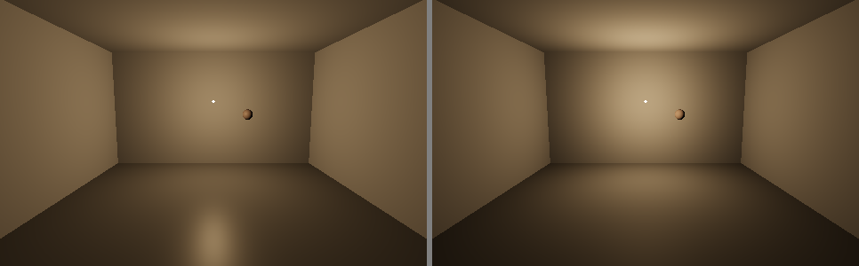
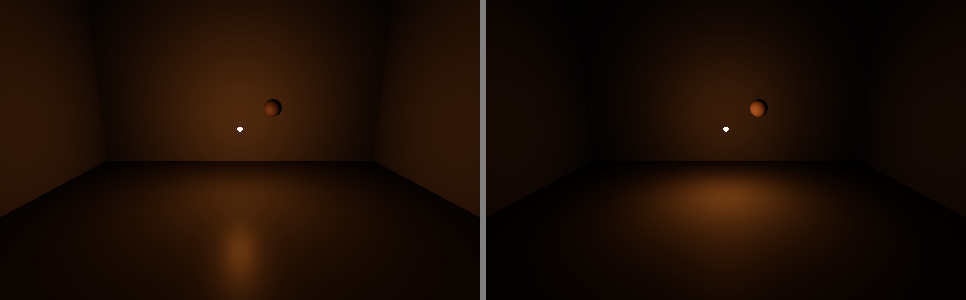
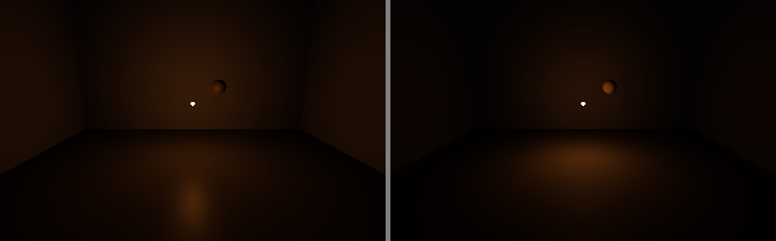
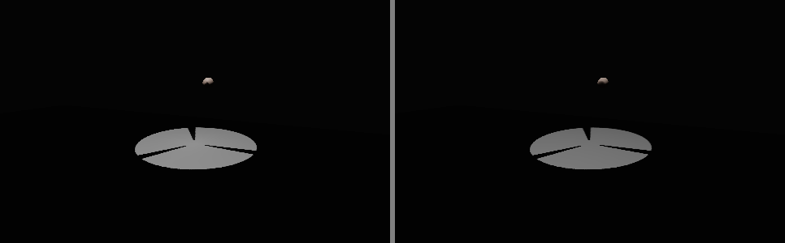
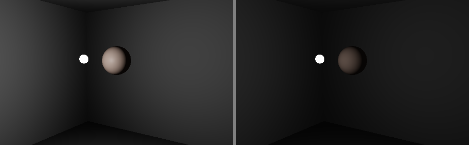

<!-- SPDX-License-Identifier: GPL-3.0-or-later -->
# Local lights like real light: point lights, projectors, body-light caps (study)

Status: study and design. Nothing here changes the viewer. The branch `codex/local-lights-study` (from `vkstorm-devel` 8d8e31b797) carries:

- this document;
- an offline GL bench, `scripts/light/bench_local_lights.py`. It compiles the viewer's own `deferredUtil.glsl`, `srgbF.glsl` and `tonemapUtilF.glsl`, unmodified, repeats the PBR branches of `pointLightF.glsl` and `spotLightF.glsl` around them for "today", and runs the proposed model beside it;
- its output: the tables in §3.5 and §4, and the side-by-side renders in `doc/light/local-lights/` (left today, right proposed).

The owner's direction (2026-11-08/09):

> the idea is to make the light behave like real light would.

> Use the sun's method of creating light, but make it parametric so it responds to script values.

> we're going to have to be careful with it, i know, we don't want to have whitewash, but i think looking at how point light and projector light scripts are defined, we can set a maximum for those parameters so that people don't go around with miniature suns in the case of body lights.

Code references are file:line at `origin/vkstorm-devel` 8d8e31b797. Shader paths are relative to `indra/newview/app_settings/shaders/`. Each claim is tagged:

- **[code]**: read in the code;
- **[measured]**: from the bench on this machine's RTX 5070 Ti (driver 621.14);
- **[inferred]**: reasoning or estimate, not yet checked.

"The light study" is `doc/light/light-model-study.md` (#429, stages L1–L7). "The shadow study" is `doc/shadows/shadow-model-rework.md` (#330, stages S1–S9; the projector atlas is its §16 and draft #332). "L1" is `doc/light/light-reference-numbers.md`.

---

## 1. Summary

**Today's local light** is a box-shaped volume of 1.5 × the prim's radius, with a `(1 − d/R)²` falloff that is bounded at the centre, a magic 3.25 (3.0 in the forward path) and no occlusion at all for point lights. The `falloff` parameter does not shape the curve: algebraically it only divides the brightness by `(1 + falloff/2)²` (§2.2). Projectors add a camera-chosen shadow for two of them and an "ambiance" that ignores shadows.

**Ranked differences from real light** (§2.6):

1. Point lights pass through walls and floors (no occlusion).
2. No inverse square: light is nearly flat across a room and then stops at 1.5 × radius, so lamps make no pools.
3. Body lights are not bounded: a 0.4 m face light puts 3.3 U on the face, 3.5 × the clear PBR noon sun.
4. Projector ambiance is light added inside the beam that ignores shadows (up to 3.25 U).
5. Projector focus blurs only beyond the focus distance, and the beam edge does not depend on the lamp.
6. The forward (alpha) path differs from the deferred one: 3.0 against 3.25, a cone instead of the projector texture, no ambiance, and only the 6 nearest lights.
7. Every source is a point, so highlights are pin-sharp whatever the lamp.

**The proposal** (§3, §4), from the values the server already sends:

- **Units.** One unit U is the clear PBR noon sun on a horizontal surface (0.95 U in L1). A real lamp is about 10 EV below the sun, and SL's night skies are only 1–2 EV below the day. So absolute lux cannot work, and the local-light scale is anchored to today's own **luminous flux** instead (§3.2).
- **Illuminance** `E = I · W(d/R) / (d² + s_eff²)`:
  - luminous intensity `I = κ(falloff) · intensity · colour · R²`, with R = 1.5 × radius as today;
  - a window `W = (1 − (d/R)^n)²`, with `n = 4 / (1 + falloff)`;
  - `κ(falloff)` keeps exactly today's flux for every falloff;
  - `s_eff = max(light size, √(I / E_cap))`. The `1/(d² + s²)` form is the exact on-axis illuminance of a Lambertian disk of radius s, so there is no singularity.
- **Projectors:**
  - inverse square from the beam's apex (setupSpotLight's `origin`);
  - **FOV** is the cone; the brightness does not change with FOV, as today (decision 3);
  - **focus** is a lens focus: the blur is the aperture's circle of confusion `2s·|l − f|/f`, so the image sharpens at the focus and blurs on both sides, and the beam edge is as soft as that blur;
  - **ambiance** becomes a shadow fill (a bounce proxy) instead of light added on top.
- **Caps** (§4):
  - **prim lights:** `E_cap = 6.5 U`, which is today's own maximum (3.25 × 2). The new model never lights a surface brighter than today's viewer can;
  - **worn lights (attachments):** `E_cap = 1.0 U` (about the PBR noon sun), and a reach of at most 6 m (radius 4 m).
- **Point-light shadows** (§5): cube maps as six tiles in the S7 projector atlas, which adds no sampler. Static lights render once and are cached, and the re-render budget is shared with projectors.
  - Tiers: 0 / 4 / 8 / 16 shadowed point lights (Low / Medium / High / Ultra).
  - Worn, tiny, dim and far lights do not cast.
  - Estimated cost: ≤ 0.1 ms GPU at 1080p for 8 lights at steady state, and CPU no worse than S7's cap.

**Stages P1–P6** (§7):

- P1–P4 (the model, the caps, projectors, highlights) can follow L3. Their caps are judged in-world after L6 (exposure).
- P5, point-light shadows, follows S7b and S3.
- About 14–20 days in total.

**Decisions for the owner** are in §8. The main ones:

- the two caps;
- flux anchoring, against a brighter "physical-ratio" scale;
- whether worn lights may cast shadows;
- whether FOV changes brightness.

---

## 2. Today's local-light model, read from the code

### 2.1 What the server sends [code]

- **Light parameters** (`LLLightParams`, llprimitive.h:143-182):
  - colour, linear RGB with the intensity in alpha, packed as 8-bit `LLColor4U` (llprimitive.cpp:1737-1755);
  - radius 0–20 m, falloff 0–2, cutoff 0–180 (clamped, llprimitive.cpp:82-90).
- **Defaults:** white, intensity 1, radius 10, falloff 0.75 (llprimitive.cpp:1727-1735).
- **Projector parameters** (`LLLightImageParams`): a texture, and `params` = (FOV rad, focus m, ambiance). Default (π/2, 0, 0) (llprimitive.cpp:2202). The build floater allows FOV 0–3, focus −20–20 and ambiance 0–1 (floater_tools.xml:3331-3420).
- **The prim's scale and rotation** come with the object. The projector uses them: the emitting face is the prim's −Z face, scale.x × scale.y (pipeline.cpp:10703-10719).
- **The viewer's colour.** `getLightLinearColor()` = colour × intensity (llvovolume.cpp:3473-3484). The build floater converts its sRGB swatch to linear (`setSRGBColor`, llprimitive.h:165). The wire value is used as linear in every shader. Whether an LSL `PRIM_POINT_LIGHT` colour arrives unconverted, and so is read as linear, is **[inferred]**; it does not change this design.
- **Cutoff** is carried but unused by the renderer [code: no shader or pipeline reader].

### 2.2 Point lights, deferred [code]

- **Selection** (`calcNearbyLights`, pipeline.cpp:6201-6387):
  - Every light within the draw distance, sorted by `distance − radius` (`calc_light_dist`, 6176-6199). Moving lights are favoured by a further `0.25 × radius` (6194-6196), and selected lights come first.
  - Lights fade in and out over `LIGHT_FADE_TIME`.
  - Skipped: HUD attachments (6309); attachments when `RenderAttachedLights` is 0 (6257, 6313; default 1); lights of avatars that are too complex, muted or too slow (6236-6243, 6318-6323).
  - Limit: `RenderLocalLightCount` (default 256, settings.xml) in the drawing loop (10261-10265). **Nothing ranks lights by brightness.**
- **Drawing** (`renderDeferredLighting`, pipeline.cpp:10243-10354):
  - The light volume is a box of half-size `s = 1.5 × radius` (10286).
  - Inside the box: up to 16 lights a pass, full screen (`LL_DEFERRED_MULTI_LIGHT_COUNT`, llviewershadermgr.h:33; 10404-10437). Outside: one box draw per light.
  - The uniforms are the colour × intensity (10295), `size` = 1.5 r, and `falloff` = 0.5 × falloff (`DEFERRED_LIGHT_FALLOFF`, 253; 10330).
- **The falloff curve** (`calcLegacyDistanceAttenuation`, deferredUtil.glsl:95-104), with x = d / (1.5 r) and f' = falloff / 2:

  `atten = 2 · (1 − (x + f')/(1 + f'))² = 2 · (1 − x)² / (1 + f')²`

  The second form is the same expression rearranged, since `1 − (x+f')/(1+f') = (1−x)/(1+f')`. So **the shape is always `(1 − x)²`**, and `falloff` only divides the brightness: by 1.00 at falloff 0, 1.89 at 0.75 and 4.0 at 2. Creators see "higher falloff = dimmer", not "fades sooner".
- **Shading:**
  - **PBR** (pointLightF.glsl:95-118, multiPointLightF.glsl:116-118): `E = 3.25 × atten × colour`, then `E × clamp(nl × (diffuse/π + spec))`. The 3.25 cancels the 1/π of the Lambert term (3.25/π = 1.03), "to balance with legacy materials".
  - **Legacy materials** (pointLightF.glsl:119-152): `colour × atten × nl × albedo`, and Blinn-Phong spec from `lightFunc`.
  - **Classic skies** multiply by 0.9 (153-156).
- **Brightest possible:** at the centre, falloff 0, intensity 1, white: E = 3.25 × 2 = **6.5 U**. At 1 m from the default light (r 10, falloff 0.75): 2.99 U.
- **No shadows, ever**, for point lights: no shadow map, and no light-map channel.
- **Highlights.** The source has no size; specular is clamped only by `perceptualRoughness ≥ 8/255` (deferredUtil.glsl:468).

### 2.3 Projectors [code]

- **Frustum** (`setupSpotLight`, pipeline.cpp:10697-10840):
  - The near plane is the prim's −Z face. The apex (`origin`) lies `dist = (scale.y/2) / tan(fov/2)` behind it, so a narrow beam from a wide face has its apex metres behind the prim.
  - The far plane is at 1.5 r + dist − scale.z.
  - `proj_lod` is log2 of the texture width.
- **Falloff and brightness** (spotLightF.glsl:128-176):
  - the same `calcLegacyDistanceAttenuation`, from the **prim centre**;
  - `3.25 × atten × texture × colour`;
  - no angular term. The beam's edge is the texture edge, faded by `getTexture2DLodDiffuse` (deferredUtil.glsl:209-227) over a width that grows with the blur LOD.
- **Focus** (`getProjectedLightDiffuseColor`, deferredUtil.glsl:247-254): `lod = clamp((l − focus)/range) × proj_lod`, where l is the distance from the near plane. The blur grows only beyond the focus distance; nearer than the focus the image is sharp.
- **Ambiance** (`getProjectedLightAmbiance`, deferredUtil.glsl:230-241; spotLightF.glsl:166-187):
  - `amb = ambiance × ((nl/2 + ½) + 1 + (nl²/2 + ½)) × atten`, at most 1. The `1 − lit` clamp never binds, because `lit` stays 0 in the PBR branch.
  - It is multiplied by the texture at its coarsest mip × colour × 3.25, and then by `nl × BRDF`.
  - So "ambiance" is up to **3.25 U of blurred light added inside the frustum**. It is **not** multiplied by the shadow: it fills projector shadows.
- **Shadows.** Only 2 projectors cast, chosen from the camera (pipeline.cpp:10766-10812; 11837-11960), read back through `lightMap.b/.a` (spotLightF.glsl:113-121). The shadow study §16 and S7b (#332) replace this with a camera-independent atlas.

### 2.4 Forward (alpha), water, probes [code]

- **Forward lights** (`setupHWLights`, pipeline.cpp:6389-6600):
  - The 6 nearest lights go to GL light slots 2–7 (`cur_light` 2…7, 6474, 6594). Slot 0 is the sun and slot 1 the avatar backlight.
  - The uniforms are `light_position/diffuse/attenuation`, and `light_deferred_attenuation` = (1.5 r, falloff/2) (llrender.cpp:1003-1032).
- **Legacy alpha** (class2/deferred/alphaF.glsl:89-172):
  - It recovers 1.5 r from the linear attenuation (the "SL-14895" comment), then `2 (1 − x)²/fa²`, the same curve. There is no 3.25.
  - Projectors become a **GL spot with exponent 2** (`spot²`). There is no texture, and the ambiance is computed but **not applied** (`SL-10969`, line 165).
- **PBR alpha** (class2/deferred/pbralphaF.glsl:214, `pbrCalcPointLightOrSpotLight`, deferredUtil.glsl:521-563):
  - The same curve, but the factor is **3.0** against the opaque path's 3.25, about 8 % darker on glass than on the wall behind it.
  - `spot²` cone, no texture, ambiance ignored.
- **No local light on water:** neither waterF.glsl uses the light uniforms.
- **No shadows** in any forward path.
- **Reflection probes.** Local lights are drawn into probe captures. They are scaled by `RenderReflectionProbeMaxLocalLightAmbiance / ambiance` (default 4.0 in settings.xml; the code fallback is 8.0) only when a probe's ambiance exceeds it (llreflectionmapmanager.cpp:801-805).

### 2.5 Exposure [code]

- **Classic skies:** no auto-exposure. `exp_min = exp_max = 1` (pipeline.cpp:7840-7841; the dynamic branch at 7858-7870 needs a probe ambiance > 0).
- **PBR skies:** ±1 EV (`2√gamma`).
- EEP HDR settings are used only with `RenderUseExposureSkySettings`, which defaults to 0.
- The tone map is ACES (Hill) at `RenderExposure` 1.
- So **today a local light's on-screen brightness is essentially fixed**: a light that is too bright whitewashes, and nothing adapts.

### 2.6 Where today differs from real light, ranked

Rank is by how often and how strongly it shows. "U": 1 U ≈ the clear PBR noon sun on a horizontal panel (0.95 U, L1 sky 2); the classic Default sky gives ≈ 3.2 U (L1 sky 1).

| # | Difference | Evidence | How it shows | Rank |
|---|---|---|---|---|
| LL1 | **Point lights are not occluded.** A lamp lights through walls, floors and ceilings up to 1.5 r | no shadow path for point lights (§2.2) | Light leaking into the next room, the floor below, or outside a house; every interior with lamps | HIGH |
| LL2 | **No inverse square.** `(1 − d/R)²` is flat near the light and ends at 1.5 r; a 10 m lamp gives 2.99 U at 1 m and 2.2 U at 3 m (ratio 1.36; real 9) | deferredUtil.glsl:95-104 | No pools of light, evenly lit rooms, lights that "stop" | HIGH |
| LL3 | **Worn lights are not bounded.** A face light (r 3, falloff 0.5) gives 3.3 U at 0.5 m, 3.5× the PBR sun; a r 20 body light lights everyone within 30 m | §2.2; pipeline.cpp:6236-6243 only skip on complexity/mute | Glowing faces, whitewashed avatars in clubs | HIGH (social) |
| LL4 | **Projector ambiance ignores shadows** and adds up to 3.25 U of blurred light in the beam | deferredUtil.glsl:230-241; spotLightF.glsl:183 | Projector shadows look washed out; ambiance > 0.3 flattens the beam | MEDIUM |
| LL5 | **Falloff does not shape the light**, it only scales it by 1/(1+falloff/2)² | algebra of deferredUtil.glsl:95-104 | Creators cannot make a light that "carries" or "fades soon"; they get brighter/dimmer | MEDIUM |
| LL6 | **Projector focus is one-sided; the beam edge does not depend on the lamp** | deferredUtil.glsl:209-227, 247-254 | Gobos are sharp everywhere nearer than the focus | LOW–MEDIUM |
| LL7 | **Forward and deferred disagree.** 3.0 against 3.25, cone vs texture, no ambiance, 6 nearest (not brightest) lights; none on water | §2.4 | Glass and alpha hair lit differently from what's behind; projector gobos absent on alpha | LOW–MEDIUM |
| LL8 | **Point sources.** Highlights do not widen with the lamp's size | deferredUtil.glsl:468 | Pin-point sparkle from big lamps on glossy floors | LOW |
| LL9 | **Only 2 projector shadows, chosen from the camera** | pipeline.cpp:10766-10812 | Handled by S7b (#332) | (S7) |

---

## 3. A physical light from the script values

### 3.1 Units, anchored on the sun

The renderer's lighting is a linear radiance before exposure. Write it as `L = BRDF · E · cos θ`, with E an illuminance in a renderer unit U:

- **Sun (PBR):** `E_sun = 3.0 × sunlit` (deferredUtil.glsl:615). L1 measured 0.95 U on a horizontal panel for the clear PBR sky at 66°.
- **Sun (classic sky):** the classic path's factors (1.35, 0.7, π, 1.1) give the equivalent of ≈ 3.2 U for the Default sky (L1 row 1, (lit − shade) · π / 0.9).
- **Local light today:** `E = 3.25 × atten × colour × intensity`, at most 6.5 U.

**[code + L1 measured]** So today, at room distances, a lamp lights a wall as brightly as the noon sun, or more.

### 3.2 Why not absolute lux

**Real ratios [inferred, textbook]:**

| Source | Illuminance |
|---|---|
| clear-sky sun | ≈ 100 klx |
| a 60 W-equivalent bulb (≈ 64 cd) | 16 lx at 2 m |
| a candle (≈ 1 cd) | 4 lx at 0.5 m |
| full moon | 0.25 lx |

Taking 1 U = 100 klx would make every lamp ≈ 1.6·10⁻⁴ U, about 12–13 EV below the sun. Showing that needs an exposure that adapts over ≈ 13 EV.

**Two things block that today:**

1. **Exposure** adapts by ±1 EV in PBR skies and not at all in classic ones (§2.5). Even L6's recommended EEP range would not cover 13 EV.
2. **SL night skies are not physical either.** A night sky's moonlight is a few tenths of a U, 1–2 EV below the day [inferred from EEP defaults; L3 will measure], where the real moon is 18–19 EV below the sun. On an absolute scale, lamps would be invisible next to SL's bright moon.

**Anchoring the scale.** So the scale is anchored to what creators already balanced: **each light keeps today's total luminous flux** (the light it emits in all directions). Its **distribution** becomes physical:

- inverse square;
- a size;
- a window to zero at the reach;
- occlusion (§5).

All the units stay in U. That keeps them comparable to the sun's, and the caps (§4) are stated against the sun.

**Option B, for decision 2.** If the owner later makes exposure and night skies physical, the same formulas take a single global factor (lux per U) and nothing else changes. This is the "physical-ratio" option, and it needs L3 + L6 first.

### 3.3 Point light: the mapping [design; values from the bench]

All values are per light, computed on the CPU in a renderer-free unit (P1) and uploaded per light. The table gives each quantity, its formula, where it comes from, and the reason.

| Quantity | Formula | From | Reason |
|---|---|---|---|
| Reach R | `1.5 × radius` (worn: `min(1.5 r, 6 m)`) | radius | the light volume, culling and the 16-light passes stay as they are |
| Window | `W(x) = clamp(1 − x^n, 0, 1)²`, `x = d/R`, `n = 4/(1+falloff)` | falloff | the standard windowed inverse square (Karis 2013 uses n = 4). Falloff now shapes: falloff 0 carries to the edge (n 4), falloff 2 fades early (n 1.33) |
| Luminous intensity I | `κ(falloff) · R² · intensity · colour` | intensity, colour, radius | E at the same fraction of R matches today's for any radius |
| κ(falloff) | `3.25 · 2/(30 (1+falloff/2)²) / (1 − 2/(n+1) + 1/(2n+1))` | falloff | equal luminous flux to today, exactly (both integrals in closed form). κ = 0.305, 0.226, 0.201, 0.181, 0.151, 0.130 for falloff 0, 0.5, 0.75, 1, 1.5, 2 |
| Size s | `clamp(0.5 × median(scale.x, scale.y, scale.z), 0.02, 0.5)` m | the prim's scale | the emitter is the prim; a 1 cm invisible prim is a 2 cm bulb, a large panel caps at a 0.5 m disk |
| Effective size | `s_eff = max(s, √(I / E_cap))` | the cap (§4) | the cap is a bigger, dimmer emitter, not a clamp: still a physical source |
| Illuminance | `E(d) = I · W(d/R) / (d² + s_eff²)` | – | `1/(d² + s²)` is the exact on-axis illuminance of a Lambertian disk of radius s. It has no singularity, and its peak `I/s_eff² ≤ E_cap` |
| Shading | `L = E · nl · BRDF(roughness widened)` | – | the same `pbrPunctual` as the sun; no 3.25, which κ absorbs |
| Highlight | `α' = min(1, α + s_eff/(2d))` | size | a large source's highlight is wider and dimmer (sphere-light widening, Karis 2013); a 2 cm bulb stays sharp |

**What falloff becomes.** It maps to the **window shape**, not to the light's size:

- The size is a property of the emitter and has its own source, the prim's scale.
- Creators use falloff to say how far the light carries.
- With flux kept per falloff, a high falloff puts more of the same light near the lamp and less far away. That is what "falloff" means to a lighting artist.

**Flux check.** By construction ∫E·d² over the reach equals today's for every falloff, whatever the radius. The bench integrates both numerically: proposed / today = 1.0000 at falloff 0, 0.75 and 2 (s → 0, no cap) [measured].

### 3.4 Projector: the mapping [design]

- **Cone (FOV).** The frustum stays exactly as `setupSpotLight` builds it: the same apex, near and far planes, aspect from scale.x/scale.y, and texture coordinates. The cone *is* the FOV.
- **Distance.** The inverse square is taken from the **apex**, not the prim:
  - a narrow beam from a wide face is nearly collimated and keeps its brightness with distance, as a real follow-spot does;
  - the window still uses the distance from the prim centre, so the reach stays 1.5 r;
  - normalisation: `I_proj = I_point × ((R/3 + a)/(R/3))²`, with `a` the apex offset, so that a projector and a point light with the same parameters give the same E on the axis at R/3.
- **Brightness against FOV** (decision 3).
  - Today it does not change with FOV, which makes `intensity` a luminous intensity (cd).
  - A real zoom spot gets brighter as it narrows (flux kept). That would multiply narrow club beams by 4–24×: FOV 0.4 against π/2 gives (tan(π/4)/tan(0.2))² ≈ 24.
  - **Recommended:** keep luminous-intensity semantics, so FOV does not change brightness. It is physical (it is a lamp of fixed candela), and it keeps every existing build's level.
- **Focus becomes a lens focus.**
  - The aperture is the emitting face, diameter `A = 2s`, with `s = clamp(√(scale.x·scale.y/π), 0.02, 0.5)`.
  - At distance l in front of the face, the blur (circle of confusion) is `c = A·|l − f|/f` metres.
  - In texture space it is `c / (2(l + a)·tan(fov/2))`, and `lod = log2(c_uv × texture size)`, clamped to the mip chain.
  - The image is sharp at the focus and blurs nearer and farther. Focus ≤ 0 is read as 0.05 m (everything in front is out of focus).
- **Beam edge.** It is soft over the same circle of confusion, at least one texel. A small lamp in focus gives a crisp edge, and a large one out of focus gives a soft edge. This replaces today's LOD-scaled edge fade.
- **Ambiance becomes shadow fill.**
  - Physically, the light in a projector's shadow is light bounced from the lit surfaces around it.
  - Proposed: `E = E_beam × (V + k · ambiance · (1 − V))`, with V the shadow visibility and k = 0.3. That is roughly a one-bounce fill in a light room [inferred], using the coarsest-mip texture colour as today.
  - Without a shadow (V = 1) it adds nothing. So the washed-out beam disappears, while a shadow is lit at up to 30 % of the beam.
  - Until projectors cast from the atlas (S7b), V is today's 2-slot shadow or 1.
- **Forward path.** The same function, with the texture where a unit is free. Otherwise a `spot²`-free hard cone with the CoC edge.

### 3.5 Worked examples: today against proposed [measured]

`scripts/light/bench_local_lights.py`, RTX 5070 Ti.

- **The tables** give, on a surface facing the light (projectors: on the beam axis):
  - E in U (× intensity; colour white);
  - the displayed sRGB value (0–255) of a white panel (albedo 0.9, roughness 1) after the viewer's `toneMapACES_Hill` at exposure 1, which is today's classic-sky exposure.
- **The images** (left today, right proposed): an analytic room (floor albedo 0.35, walls 0.6, a head-sized sphere), a uniform ambient of 0.01–0.03 U, ACES at exposure 1. There are no shadows in either half: point lights cast none today, and the proposed shadows come in P5.
- `E_cap` is 6.5 U for prim lights and 1.0 U for worn ones.

**Room lamp:** prim point light, radius 6, falloff 0.75, intensity 1, warm white, 1.6 m up, bulb 0.1 m.

| d (m) | 0.1 | 0.25 | 0.5 | 1 | 1.5 | 2 | 3 | 4 | 5 | 6 | 8 |
|---|---|---|---|---|---|---|---|---|---|---|---|
| E today (U) | 3.36 | 3.25 | 3.07 | 2.72 | 2.39 | 2.08 | 1.53 | 1.06 | 0.68 | 0.38 | 0.04 |
| E proposed (U) | 6.47 | 6.34 | 5.89 | 4.58 | 3.31 | 2.34 | 1.19 | 0.63 | 0.32 | 0.15 | 0.01 |
| white panel today | 201 | 199 | 196 | 189 | 181 | 172 | 150 | 123 | 92 | 59 | 4 |
| white panel proposed | 228 | 227 | 225 | 215 | 200 | 180 | 132 | 87 | 51 | 26 | 0 |

- Near the lamp, the light is brighter but never above today's 6.5 U ceiling.
- At 3–5 m it is 20–50 % dimmer, so the lamp makes a pool. The corners and the far floor go darker, as in a real room lit by one lamp.
- The floor highlight is wider and softer, because the cap acts as a 1.6 m diffuser.

**Candle with a flicker script:** radius 3, falloff 1.5, colour (1, 0.65, 0.3), wick 2 cm, 0.85 m up. The script varies intensity 0.6–1.0.

| d (m) | 0.1 | 0.25 | 0.5 | 1 | 1.5 | 2 | 3 |
|---|---|---|---|---|---|---|---|
| E today, intensity 1.0 / 0.6 | 2.03 / 1.22 | 1.89 / 1.14 | 1.68 / 1.01 | 1.28 / 0.77 | 0.94 / 0.57 | 0.66 / 0.39 | 0.24 / 0.14 |
| E proposed, intensity 1.0 / 0.6 | 6.34 / 3.80 | 5.63 / 3.38 | 3.99 / 2.40 | 1.72 / 1.03 | 0.77 / 0.46 | 0.36 / 0.22 | 0.07 / 0.04 |
| white panel today, 1.0 / 0.6 | 170 / 133 | 165 / 128 | 157 / 119 | 137 / 100 | 115 / 81 | 90 / 61 | 39 / 24 |
| white panel proposed, 1.0 / 0.6 | 227 / 207 | 223 / 201 | 209 / 181 | 159 / 121 | 100 / 69 | 56 / 36 | 10 / 5 |

 

- The candle makes a small, bright pool on the table, and the room beyond 1.5 m is darker: a real candle.
- **Flicker depth.** Intensity flicker is proportional in both models. Many flicker scripts also jitter the **radius**, and the proposal makes that stronger, because I ∝ R². For radius 2.5↔3.5 with intensity 0.6↔1.0, the bright/dim ratio is [measured, the bench's Python tables]:

  | Distance | Today | Proposed |
  |---|---|---|
  | 0.5 m | 1.8 | 1.7 |
  | 1 m | 2.0 | 2.7 |
  | 2 m | 2.9 | 4.5 |

  Real flames flicker in flux, not in reach, so this is more physical. It is listed for the owner's check (§6).

**Club spotlight:** projector, radius 20, falloff 0, FOV 0.4, focus 8 m, ambiance 0.2, a 0.3 m face, 8 m up, aimed 19° off vertical, disc gobo with bars.

| d (m) on axis | 0.25 | 0.5 | 1 | 1.5 | 2 | 3 | 5 | 8 | 10 | 15 | 20 | 25 |
|---|---|---|---|---|---|---|---|---|---|---|---|---|
| E today (U) | 6.39 | 6.29 | 6.07 | 5.87 | 5.66 | 5.26 | 4.51 | 3.50 | 2.89 | 1.62 | 0.72 | 0.17 |
| E proposed (U) | 1.43 | 1.42 | 2.24 | 4.10 | 4.90 | 4.55 | 3.91 | 2.51 | 1.88 | 0.93 | 0.42 | 0.12 |
| white panel today | 230 | 230 | 229 | 228 | 227 | 225 | 220 | 209 | 200 | 164 | 105 | 32 |
| white panel proposed | 145 | 145 | 177 | 210 | 218 | 215 | 208 | 184 | 165 | 114 | 64 | 19 |

- On the dance floor (8–9 m) the beam is about 30 % dimmer than today, and the gobo is sharp at the focus as before.
- Within 1 m of the lamp the gobo is out of focus. Its blurred bars lower the axis value, which is what a real gobo does close to the lens.
- Ambiance 0.2 no longer adds a glow inside the beam. It fills the beam's shadows once projectors cast (S7b).

**Face light (worn):** radius 3, falloff 0.5, intensity 1, white, 2 cm, 0.4 m in front of the face.

| d (m) | 0.1 | 0.25 | 0.5 | 1 | 1.5 | 2 | 3 | 4 |
|---|---|---|---|---|---|---|---|---|
| E today (U) | 3.98 | 3.71 | 3.29 | 2.52 | 1.85 | 1.28 | 0.46 | 0.05 |
| E proposed (U) | 1.00 | 0.99 | 0.94 | 0.79 | 0.60 | 0.42 | 0.15 | 0.02 |
| white panel today | 209 | 206 | 200 | 184 | 164 | 137 | 69 | 6 |
| white panel proposed | 119 | 118 | 115 | 102 | 84 | 64 | 25 | 0 |

- The face is lit like a face in daylight (≈ 1 U), not 3.5× brighter.
- The room around the avatar barely changes, and the light is gone by 4 m.

### 3.6 What the bench does not show

- Shadows (P5).
- Probes, SSAO, exposure adaptation, the classic-sky 0.9 factor (the bench runs `classic_mode` 0), and legacy (non-PBR) materials. Those get the same E with their own BRDF (§7, P2).

---

## 4. Caps against whitewash

### 4.1 Prim lights: `E_cap = 6.5 U`

- **Value.** 6.5 U is `3.25 × 2`, the highest illuminance today's viewer can produce: intensity 1, white, falloff 0, at the light's centre.
- **How it acts.** The cap becomes a minimum emitter size `s_eff = √(I/6.5)`:

  | Light | s_eff |
  |---|---|
  | r 1 | 0.32 m |
  | r 5 | 1.6 m |
  | r 10 | 3.2 m |
  | r 20 | 6.5 m |

  Small lights are fully physical. Big ones behave like big diffuse emitters near the lamp and like inverse square beyond s_eff.
- **Rationale.** With this cap the new model never lights any surface brighter than today's viewer could. The whitewash risk is no higher than today's anywhere, and lower at room distances. A white panel at the cap displays 228/255 at exposure 1.
- **The dial (decision 1).** A higher cap shows more of real light's near-field contrast. Room lamp (r 6), E at 0.25 / 1 / 2 / 4 m:

  | E_cap | 0.25 m | 1 m | 2 m | 4 m | E(1 m)/E(2 m) |
  |---|---|---|---|---|---|
  | today's model | 3.25 | 2.72 | 2.08 | 1.06 | 1.31 |
  | **6.5 (proposed)** | 6.34 | 4.58 | 2.34 | 0.63 | 1.96 |
  | 13 (+1 EV) | 12.4 | 7.13 | 2.90 | 0.67 | 2.46 |
  | 26 (+2 EV) | 23.6 | 9.87 | 3.29 | 0.70 | 3.00 |
  | none (pure inverse square) | 224 | 15.9 | 3.80 | 0.72 | 4.18 |

  Pure physics wants 4.2 (a little under the bare 4 because of the window). The proposed cap gets halfway there in EV terms and stays within today's ceiling.

### 4.2 Worn lights (attachments): `E_cap = 1.0 U`, reach ≤ 6 m

- **Which lights.** `isAttachment()` on the light's object, in the light gathering (pipeline.cpp:6249-6257, 6302-6323), excluding HUDs (already skipped). The caps go into the per-light values that the renderer-free unit computes (P1), so the shaders do not know about attachments.
- **The caps:**
  - `E_cap_worn` = 1.0 U: about the clear PBR noon sun (0.95 U), a third of the classic sun (3.2 U);
  - reach `min(1.5 r, 6 m)`, so radius 4 m at most. With I ∝ R², a radius-20 body light is treated as radius 4.
  - intensity and colour as sent.
- **Rationale:**
  - A face or body light should light its wearer as a well-lit room or daylight would, not glow. 1 U on skin (albedo 0.45) displays ≈ 75/255 at exposure 1, a normally lit face, not a glowing one.
  - It must also not light the club: a real handheld light (≈ 100 lm, ≈ 8 cd) puts 0.5 lx at 4 m. 6 m of reach covers the wearer's partner and the nearby floor.
  - This is the owner's "no miniature suns".

  | Worn light | 0.3 m | 0.5 m | 1 m | 2 m | 4 m | 8 m |
  |---|---|---|---|---|---|---|
  | r 1, falloff 0 | 4.16 → 0.88 | 2.89 → 0.71 | 0.72 → 0.26 | 0 | 0 | 0 |
  | r 3, falloff 0.5 | 3.62 → 0.98 | 3.29 → 0.94 | 2.52 → 0.79 | 1.28 → 0.42 | 0.05 → 0.02 | 0 |
  | r 10, falloff 0.75 | 3.30 → 0.99 | 3.21 → 0.96 | 2.99 → 0.85 | 2.58 → 0.54 | 1.85 → 0.11 | 0.75 → 0 |
  | r 20, falloff 0 | 6.37 → 0.99 | 6.29 → 0.98 | 6.07 → 0.92 | 5.66 → 0.71 | 4.88 → 0.26 | 3.50 → 0 |

  E today → E proposed, in U [measured: the bench's Python tables, the same formulas as its GLSL].
- **Everyone's lights get the same caps**, the wearer's own included. The caps describe the light, not the viewer.
- **Muted, too-complex and too-slow avatars** keep losing their lights as today (pipeline.cpp:6236-6243). `RenderAttachedLights` keeps its meaning.
- **Not proposed:** detecting a "face light" by attachment point. Every worn light is treated alike, whatever the attachment point; that is simpler and harder to game.

### 4.3 How exposure (L6) interacts

The caps are in scene units, before exposure. On screen, a white panel at the cap displays (ACES Hill, transcribed from tonemapUtilF.glsl; it matches the bench to ±2/255) [measured]:

| E on a white panel | exposure ×0.5 (−1 EV) | ×1 | ×2 (+1 EV) | ×4 (+2 EV) |
|---|---|---|---|---|
| 1.0 U (worn cap) | 75 | 121 | 171 | 211 |
| 3.3 U (today's face light at 0.5 m) | 158 | 201 | 229 | 243 |
| 6.5 U (prim cap = today's max) | 201 | 228 | 243 | 250 |

What follows:

- **Today** (classic skies with exposure fixed at 1, PBR skies at ±1 EV), the caps hold on screen as computed.
- **If L6 widens adaptation to +2 EV** in dark scenes, a dark room lit only by a worn light adapts up, and the face reaches ≈ 211/255. That is like an eye adapting to a dim room, not a whitewash. The prim cap is already at the top of the curve, so it barely changes.
- **The real whitewash risk under a wider L6** is a bright light in a dark, wide view, where the metering lifts the exposure. L6's metering is centre-weighted, and the caps bound the brightest surface.
- **Recommendation:** fix the caps now in U, judge them in-world once with L6 in place (§7), and do not tie the caps to the exposure. The light is the scene; exposure is the eye.
- **Classic skies** keep their extra 0.9 on local lights (today's `final_scale`). The classic sun is ≈ 3.4× brighter than the PBR sun (L1), so local lights look relatively weaker in classic skies, as today.

---

## 5. Shadows for local lights

### 5.1 Which technique for point lights

| | Cube map (6 faces) | Dual paraboloid (2) | Tetrahedron (4) |
|---|---|---|---|
| Renders per light | 6 frusta (one cull) | 2 | 4 |
| Geometry | exact for any mesh | **wrong for large triangles**: the warp is per vertex, so straight edges of floors, walls and low-poly prims bend. SL content is full of large triangles | exact |
| Seams | between faces; handled with a 1–2 texel border | at the equator, worst | between faces, wider frusta |
| Atlas fit | 6 square tiles | 2 square tiles | 4 triangular areas in square tiles (25 % waste) |
| Filtering, PCSS | per face, as projectors | distorted kernels | per face |

**Recommended: cube faces as six square tiles in the S7 projector atlas.**

- Each face is a 90° perspective, rendered at a slightly wider angle `2·atan(1 + 2b/size)` so that the filter stays inside the tile (border b = 2 texels).
- The pixel shader picks the face by the major axis of `pos − light` and maps it to its tile rect.
- **No new sampler.** The atlas sampler that S7b already adds is reused, which matters for the 16-texture-unit limit on older GPUs.
- One light-space cull per light (its sphere) feeds the six submissions, with a per-drawable face test on the CPU. That costs one cull instead of six.

### 5.2 Penumbra from the light's size

- **PCSS penumbra:** `w = s · (d_receiver − d_blocker) / d_blocker`, with s the physical size of §3.3 (prim scale, 0.02–0.5 m).
  - A 2 cm bulb gives crisp shadows; a 0.5 m globe gives soft ones.
  - It is the same formula the shadow study uses for projectors (§9.3 there). For projectors, S becomes the face's equivalent disk radius of §3.4, instead of "the radius parameter, clamped".
- **The cap's virtual size is not used for shadows.** `s_eff` from §4.1 shapes only the near-field illuminance; otherwise every r 10 lamp would cast 3 m-wide penumbras.
  - This is the one place the model is deliberately not self-consistent. It keeps the photometric cap from blurring shadows.
  - Decision 1b: use `s_eff`, or s.
- **Filtering.** As projectors in S7b: 12 Poisson taps with per-pixel rotation and the blocker search, clamped to the tile. Point-light shadows are sampled in the per-light pass. Shadowed point lights leave the 16-light full-screen batch and use the single-light program with a `SHADOW` variant, so the batched path keeps its cost.

### 5.3 What does and does not cast

**Camera-independent rule** (as S7b's): a point light casts if all of these hold, whatever the view direction:

- its reach sphere comes within the shadow distance of the camera position;
- it passes the filters below;
- the tier's count allows it.

**Priority** (stable, no view direction): the light's illuminance at the camera position with the reach clamped, `I / max(d_cam, R/3)²`. Ties go to the longer-lived light. A light that loses its slot fades over 0.25 s, as S7b's tiles do.

**Filters, proposed defaults:**

| Light | Casts? | Reason |
|---|---|---|
| prim point light, r ≥ 1 m, `intensity × max(colour)` ≥ 0.1 | yes | a room lamp, a street light |
| r < 1 m (reach < 1.5 m) | no | candles and tiny accents; the shadow would be a few pixels. P5 can lower this per tier |
| `intensity × max(colour)` < 0.1 | no | too dim to see a shadow |
| worn (attachment) | **no** (decision 4) | moves every frame, so its tile is dirty every frame; there are many of them in clubs; a face light's own nose shadow is what wearers do not want |
| moving prim lights (vehicles, scripted motion) | yes, lowest priority | dirty every frame; they take budget only after static lights |
| in reflection probes / cube snapshots | no | probes keep their cheap path (shadow study §9.5) |
| on forward/alpha receivers | no | as projectors today; alpha surfaces are lit unshadowed |
| under water | no | owner decision 2026-11-03 (no shadows under water) |

### 5.4 Cost, tiers and the gate

**Measured basis** (shadow study §16, `bench_projector_shadows.py`, 5070 Ti):

- **Tile render:** 0.006 / 0.021 / 0.078 ms for 0.05 / 0.25 / 1 Mtri. It is geometry-bound and independent of the tile size.
- **Lighting:** a full-screen projector shadow term costs 0.018 ms on a 256² tile and 0.044 ms on 512², against 0.284 ms for a separate 1920² map.

**Estimates for point lights [inferred]:**

- **Render, per light update:** 6 faces × the triangles in the face. Each face sees about a sixth of the sphere's casters: in a furnished room, 50–250 ktri in range → ≈ 0.01–0.02 ms GPU for all six faces. CPU: one cull + six submissions ≈ C to 1.5 C, where C is one `renderShadow` today (not measured offline; the shadow study §16.1 gives the in-world check).
- **Steady state, static room:** 0 re-renders a frame, apart from S7b's 2 s safety refresh (one light every 2 s per light), which is spread over frames.
- **Lighting:** a shadowed point light is evaluated only inside its volume. One face lookup + 12 taps ≈ the projector term: ≈ 0.025 ms (PCF) / 0.055 ms (PCSS) for a light covering the whole 1080p screen, ∝ the covered pixels. A typical room lamp covers 20–40 % of the screen → 0.01–0.02 ms.

**Tiers** (extending the shadow study §16.4; memory in D24, 4 B a texel):

| | Low | Medium | High | Ultra |
|---|---|---|---|---|
| Shadowed point lights | 0 | 4 | 8 | 16 |
| Face size | – | 256² | 256² (512² for the 2 highest priority) | 256² (512² for the 4 highest priority) |
| Atlas use | – | 24 × 256² = 6.3 MB of the 36 MB atlas | 36 × 256² + 12 × 512² ≈ 22 MB of 64 MB | 72 × 256² + 24 × 512² ≈ 44 MB of 96 MB |
| Re-renders a frame, shared with projectors | – | 2 | 3 | 4 |
| Lighting GPU, steady state, 1080p | – | ≤ 0.06 ms | ≤ 0.12 ms | ≤ 0.25 ms |
| Mid-class GPU (×3, as the shadow study) | – | ≤ 0.18 ms | ≤ 0.36 ms | ≤ 0.75 ms |

- **Budget.** A point-light update counts as **one** re-render in the budget, since its cost is one cull + six cheap submissions. With 2 a frame at Medium, a club of 30 moving lights refreshes each tile every 15 frames, as S7b's projectors do. Static lights cost nothing at steady state.

**Gate for P5** (in-world, the shadow study §2.5 protocol: Frame Profile, the reference scenes at 1080p and 1440p, 3 runs):

- static furnished room with 6 lamps: 0 re-renders a frame at steady state, and lighting GPU ≤ +0.08 ms at 1080p against P4;
- the club: CPU shadow submission ≤ the S7b cap (2C at Medium), and no frame-time spike over 1 ms when a light enters;
- FPS drop shadows off → on stated per tier, and not more than the projector atlas alone at the same tier + 10 %;
- no visible seams on a cube-face boundary in the bench's test (a plane through the light at 45°).

---

## 6. Compatibility: showing the owner before and after

Every lit build will look different: lights pool and stop leaking (P5), face lights calm down, and projector ambiance changes. Three tools:

1. **Offline, now:** `scripts/light/bench_local_lights.py`.
   - It writes the tables of §3.5 and the side-by-side PNGs in `doc/light/local-lights/`, with the viewer's own shader functions for "today" and its own tone map.
   - The owner can add examples: a dict per light, with the parameters as in the build floater.
   - P1 adds vectors from the C++ unit, checked against the bench's GLSL, as L1 does for the sun.
2. **In-world, on the feature branch (debug settings, no Preferences entries):**

   | Setting | Default on the branch | Meaning |
   |---|---|---|
   | `RenderLocalLightPhysical` | 1.0 | blend per light: `E = mix(E_today, E_proposed, k)`, so 0 is today exactly. It costs one `mix`; both curves are a few ALU ops |
   | `RenderLocalLightCapPrim` | 6.5 | U |
   | `RenderLocalLightCapWorn` | 1.0 | U |
   | `RenderLocalLightReachWorn` | 6.0 | m |
   | `RenderLocalLightShadows` | per tier | 0 off, else the tier count (P5) |

   - The blend lets the owner sweep 0 → 1 in one place and judge. `0` must give pixel-identical output to today: an equivalence check in P2, with the `test_graphics_identity.py` approach.
   - **A split-screen comparison** (today left, proposed right) is a development diagnostic only. It lives on the feature branch, is never integrated into release, and `scripts/tests/check_release_hooks.py` guards it.
3. **The owner's in-world check** (once, on the installed build after release, as agreed). The places to look:
   - a furnished home at night with 2–4 lamps;
   - a club with projectors and a crowd with body lights;
   - a candle-lit scene with flicker scripts;
   - a portrait with a face light.

   Points to check:
   - pools, and no leaks (after P5);
   - faces not glowing;
   - beams with sharp gobos at focus;
   - candles flickering, not throbbing (§3.5).

**Not proposed:** a per-object "legacy light" flag. The server cannot carry one, and a viewer-side list would diverge between viewers.

---

## 7. Staged plan

Each stage:

- is a `codex/` feature PR from `vkstorm-devel`;
- is built RelWithDebInfo and staged, with no installer;
- gets integration PRs per line after qualification;
- has renderer-free logic in a unit with tests (`lllocallight.h`, shared later with the Vulkan line);
- adds no Preferences entries;
- keeps diagnostics off release.

OpenGL behaviour outside the change stays identical, and blend 0 = today (P2's equivalence test).

| Stage | Scope | Performance gate | Owner checks in-world | Effort |
|---|---|---|---|---|
| **P1** Renderer-free mapping | `lllocallight.h`: params + scale + attachment flag → {I, R, n, κ, s, s_eff, caps, projector apex, aperture, CoC constants}; unit tests incl. the flux identity and the caps; vectors checked against the bench's GLSL; CI beside `llatmosphericlight_test.cpp` | none (CPU, per light per frame: < 1 µs) [inferred] | nothing; reads the tables | 1–2 days |
| **P2** Point lights, deferred + forward | One `localLightE()` in deferredUtil.glsl used by pointLightF, multiPointLightF, pbralphaF, alphaF, materialF; per-light uniforms (I, s_eff, n, R); the 3.0/3.25 split removed (κ carries it); classic 0.9 kept; legacy materials get the same E with their BRDF; debug blend and caps | local-lights GPU (Frame Profile "local lights" + "fullscreen lights") ≤ +5 % at 1080p/1440p in a club and a lit room; blend 0 pixel-identical | Home at night, candles, face light, at blend 0 and 1 | 3–4 days |
| **P3** Projectors | apex inverse square, CoC focus and edge, ambiance as shadow fill (V from today's 2 slots until S7b), forward path without the `spot²` cone | spot passes ≤ +5 %; no extra sampler | Club beams and gobos; projector-lit rooms | 2–3 days |
| **P4** Highlights, probes, forward selection | Roughness widening by size; the forward 6 lights ranked by illuminance at the camera, not distance; probe captures use the new E (with today's `RenderReflectionProbeMaxLocalLightAmbiance` scale) | ≤ +1 % | Glossy floors under lamps; glass and alpha hair near lights | 1–2 days |
| **P5** Point-light shadows | Cube faces in the S7b atlas, per-light shadowed program variant, PCSS from size, priority and filters of §5.3, shared re-render budget | §5.4 gate | Lamps stop lighting the next room and the floor below; soft vs crisp shadows by bulb size | 6–8 days |
| **P6** Tiers | Point-light counts and face sizes in S8's `RenderShadowQuality` tiers and the feature table | every tier within §5.4 | FPS drop per tier stated | 1 day (inside S8) |

**Placement against the light and shadow stages:**

- **P1–P4 do not touch the sun, sky or exposure code.** They can start after L3 and run beside L4–L5.
- **The caps' in-world judgement needs L6.** Exposure decides how a capped light looks in a dark room (§4.3). So P2 and P3 merge after L6, or their cap defaults are re-checked once L6 is in. The debug settings allow re-tuning without code.
- **P3's ambiance fill becomes fully useful only after S7b**, when every projector casts. Until then it fills only the 2 camera-chosen shadows, or nothing.
- **P5 needs S7b's atlas and S3's PCSS path.** It goes after S7b and before S8, and P6 folds into S8.
- **L1–L7, S2–S9:** unchanged by this study. Suggested order:

  `L2 → L3 → (P1 ∥ L4) → (P2–P4 ∥ L5) → L6 → owner check of P2–P4 caps → S2 → S3 → S4–S6 → S7b → P5 → S8 (+P6) → S9`

  L7 (volumetric clouds) runs in parallel as the light study says.

**Effort:** P1–P4 7–11 days; P5 6–8 days; P6 ≈ 1 day; **total ≈ 14–20 days**, plus the integration PRs per line.

---

## 8. Decisions for the owner

1. **The prim cap `E_cap`.**
   - *Recommended:* 6.5 U, today's maximum, so nothing gets brighter than today anywhere.
   - Raising it (13 U, 26 U, none) shows more real near-lamp contrast at the cost of brighter hot spots (§4.1).
   - **1b.** Should shadow penumbras use the physical size s (*recommended*) or the cap's virtual size?
2. **The scale anchor.**
   - *Recommended:* flux equal to today's per light (§3.2).
   - The alternative is a physical-ratio scale (1 U = 100 klx, lamps 12–13 EV below the sun). It needs L3's physical night and an exposure range of ≈ 13 EV, and it is not proposed now.
3. **FOV and brightness.**
   - *Recommended:* luminous-intensity semantics (FOV does not change brightness, as today).
   - The alternative is flux semantics (a narrower beam is brighter), with a gain clamp of ×4 to stay out of whitewash.
4. **Worn lights:**
   - (a) `E_cap_worn` 1.0 U and reach 6 m (*recommended*; range 0.5–2 U, 4–8 m);
   - (b) worn lights never cast shadows (*recommended*);
   - (c) the same caps for one's own lights as for others' (*recommended*).
5. **Falloff → window shape with flux kept** (*recommended*), instead of today's pure brightness divisor. Builds with high falloff become brighter near the light and darker far away.
6. **Projector ambiance → shadow fill** (k = 0.3; *recommended*), instead of light added in the beam. Builds that used ambiance as a "glow" lose it.
7. **Flicker scripts that jitter the radius** flicker more (I ∝ R²). *Recommended:* accept it, since it is physical. The alternative is to tie I to a slow-moving radius, which the viewer cannot tell apart from a creator's change.
8. **Point-light shadow tiers:** 0 / 4 / 8 / 16 lights and the face sizes of §5.4 (*recommended*), shared with the projector budget.

---

## 9. What was verified and what is inferred

**Verified in code:**

- every row of §2 with file:line;
- the algebra of falloff (§2.2);
- the 1.5 × radius and 0.5 × falloff factors;
- the 3.0/3.25 split;
- projector ambiance ignoring the shadow;
- the forward path's 6 lights, cone and ignored ambiance;
- no local lights on water;
- the exposure ranges.

Settings defaults were read from settings.xml:

| Setting | Default |
|---|---|
| `RenderLocalLightCount` | 256 |
| `RenderAttachedLights` | 1 |
| `RenderShadowDetail` | 2 |
| `RenderReflectionProbeMaxLocalLightAmbiance` | 4.0 |
| `RenderExposure` | 1.0 |
| `RenderTonemapType` | 1 |

**Measured** (offline, 5070 Ti only):

- every table in §3.5, with the viewer's unmodified `deferredUtil.glsl`, `srgbF.glsl` and `tonemapUtilF.glsl`;
- the images in `doc/light/local-lights/`;
- the κ, flux, cap, worn-light and flicker tables (§3.3, §3.5, §4.1, §4.2), from the bench's Python version of the same formulas. It agrees with the bench's GLSL to the printed precision where they overlap;
- the exposure table of §4.3, from a Python transcription of `toneMapACES_Hill`, which matches the bench's GLSL tone map to ±2/255.

**Inferred:**

- the real-world photometry (§3.2);
- that LSL colours arrive unconverted;
- the shadow costs for point lights (§5.4), extrapolated from S7b's measured tile and lighting costs;
- the CPU cost (C per light update);
- k = 0.3 for the ambiance fill;
- that a +5 % local-light pass cost is enough room for P2. The proposed curve adds a `pow`, a `max` and a division per light per pixel, against `pbrPunctual`'s ~100 operations.

**Not measured:** any in-world frame time, and any second GPU.

---

## 10. Sources

- Karis, *Real Shading in Unreal Engine 4*, SIGGRAPH 2013 course notes: windowed inverse-square falloff `(1 − (d/r)⁴)²/(d² + 1)`, sphere-light roughness widening. Public formulas only.
- Lagarde & de Rousiers, *Moving Frostbite to Physically Based Rendering*, SIGGRAPH 2014: photometric light units, the `1/max(d², r²)` minimum distance, the disk-source illuminance `πL·s²/(d² + s²)`.
- Fernando, *Percentage-Closer Soft Shadows*, NVIDIA 2005 (the paper's formula only, as in the shadow study; no sample code).
- Gerasimov, *Omnidirectional Shadow Mapping*, GPU Gems ch. 12; Brabec, Annen & Seidel, *Shadow Mapping for Hemispherical and Omnidirectional Light Sources*, 2002 (dual paraboloid). Read for the trade-offs; no code used.
- Koonce, *Deferred Shading in Tabula Rasa*, GPU Gems 3 ch. 19: a shadow-map pool with caching and an update budget (the S7b template, extended here).
- The shadow study §16 (#330) and S7b (#332), the light study (#429), L1 (`doc/light/light-reference-numbers.md`).
