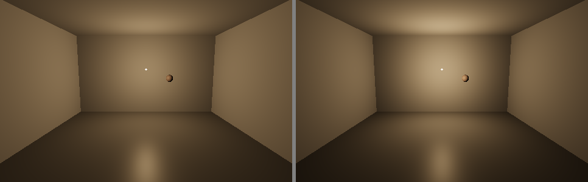
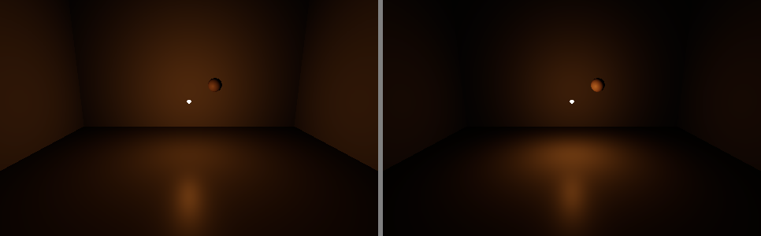
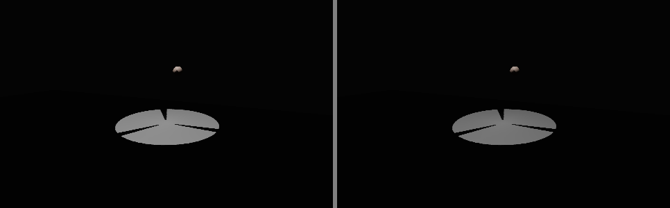
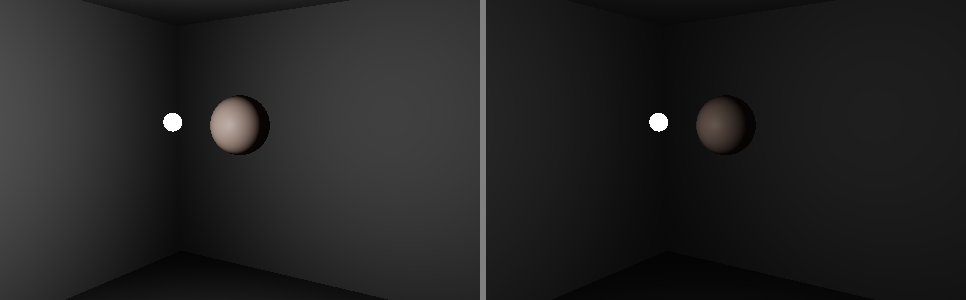

<!-- SPDX-License-Identifier: GPL-3.0-or-later -->
<!-- Copyright (C) 2026, Anne Skydancer (Vulkanstorm) -->
# Local lights like real light, and point-light shadows on the projector pool (study, refresh of 2026-11-16)

Status: study and design. Nothing here changes the viewer. It supersedes study #437 (branch `codex/local-lights-study`, from
`vkstorm-devel` 8d8e31b797), which the owner closes. Everything is re-read on **`vkstorm-devel` 191c9985b9** (2026-11-16 18:55: projector
pool P1 to P4, sharpness P2 #527, revectorized lamp edges #536, cells and camera-position tile sizing #539, OpenGL 4.6 floor #537, the dark
sun skip #540, the change-index hotfix).

The branch carries:

- this document;
- `scripts/light/bench_local_lights.py`, the #437 bench brought up to the owner's rules of 2026-11-13 to 11-16 (every lamp a 1 cm
  emitter, the projector ambiance kept shadowed, a focus that keeps today's far blur) and with a `--time` mode (GPU time of a 16-light
  pass, today's curve against the proposed one; it holds `.fixture-tmp/gpu-bench.lock`);
- its renders in `doc/light/local-lights/` (left today, right proposed).

It builds on, and does not repeat:

- `doc/shadows/point-light-shadows-plan.md` (#513, #521; "the plan") and its offline Q0 bench, `doc/shadows/point-faces-q0-results.jsonl` (#525);
- `doc/shadows/projector-shadow-pool.md` and `projector-pool-budget.md` (the pool);
- the OpenGL review of the plan's GL path, `reports/point-light-gl-2026-11-16/report.md` (owner: "ok"; kept on the owner's machine,
  `reports/` is untracked; "the GL review");
- today's measured split, `reports/rooftops-ultra-shadow-split-2026-11-16.md` ("Rooftops"), and `doc/perf/multicore-baseline-2026-11.md`.

Shader paths are relative to `indra/newview/app_settings/shaders/`. Labels: **[V]** read in the code at 191c9985b9, **[M]** measured
(machine and date given), **[E]** estimate, **[I]** inferred and not checked.

**Decided by the owner, not asked again here:** for point-light shadows, six cube faces per lamp, two tiers by camera position, a separate
atlas, measure before the budget, avatars cast from all lamps, D1 to D4, D6, D8 of the plan, D7 = D′ (instanced faces, face from a
per-instance attribute), the GL review's recommendations; every lamp a 1 cm emitter with the P2 filter and softness 0.23
(`RenderShadowLightSize`); fixed objects and avatars cast, physical objects, movers and worn lights do not; the emitter prim is the fixed
point and its linkset is the fixture. For the light model (#437, 2026-11-09, "all as recommended"): flux anchored to today, prim cap
6.5 U, worn lights 1 U and 6 m reach and no shadows and the same for one's own, FOV does not change brightness, falloff becomes the window
shape, radius-jitter flicker accepted, caps judged in-world after L6.

---

## 1. Summary

**The #437 findings on devel** (section 2): the falloff formula, the 3.25 against 3.0 split, the unbounded worn lights and the missing
point-light occlusion are **still true**, line for line. The projector ambiance **changed**: under the pool it is multiplied by the
shadow since P2c, so it stops where the beam stops (Legacy still adds it unshadowed). The two camera-chosen projector shadows are
**fixed** by the pool (Stochastic, detail 2).

**Today's numbers decide the order** (section 3). At Rooftops (about 50 avatars, Ultra) devel runs at **28 fps standing** with all shadows
and 43 fps with none: the 60 fps floor is missed before any of this work, and the frame is main-thread CPU bound. The lamps cost
**1.3 to 1.5 ms** a frame because **one projector tile is re-rendered every frame**, and the avatar-layer path never ran there.

**That pool behaviour must be fixed first** (section 4). The point pool shares the pool's one CPU ledger: a projector tile that runs as the
"progress pick" every frame leaves the ledger spent, and `selectFrame` then hands the point pool nothing (`llprojectorshadowpool.h:1725-1730`).
If the cause is the feed's "everything is stale" signal, the point faces would be stale for ever too, and the point pool would add a
second permanent re-render. Two stages, **R0** (read the pool's stats in the Rooftops scenario that now exists) and **R1** (fix the cause,
make the cap hold on average, trim the per-tile pin walk), come before any point face.

**Point-light shadows** (section 5) are the plan's stages, re-cut on what devel now has: the GL review's D′ route, the pool's scheduler,
change index, LOD pin, combined cap, avatar layer, footprint copy, cells' guard rule and P2 filter. One new rule: the own avatar's
every-frame faces are limited to the K = 2 near lamps; the pool's own-avatar exemption applied to 55 lamps would cost about 1 to 2 ms a
frame outside the cap. Steady state costs about **0.2 to 0.7 ms GPU and under 0.1 ms CPU** at 1440p in the owner's 59-lamp room [E],
plus the shared cap while avatars stand under lamps; the first fill takes about 1.6 to 9 s at 60 fps [E].

**The light-model half** (section 6) is six stages (M1 to M6), each a separate look change behind one debug blend. The 1 cm emitter rule
leaves the #437 tables unchanged (the caps set the near-field size), keeps highlights as sharp as today, and makes a lens aperture from
the prim impossible, so the focus needs a new rule (decision L-3). Measured: the proposed curve adds **+0.083 ms** to a 16-light
full-screen pass at 2560 x 1440 (0.194 to 0.277 ms) [M].

**Effort** (section 9), calibrated on this repo's history: about **21 to 38 hours of pipeline time** for everything, plus two or three
owner sessions; R0 and R1 alone about 3 to 5 hours.

**Open decisions** (section 8): R-1 the amortised cap; R-2 restless objects (only if R0 finds them); L-1 the projector ambiance (keep it
shadowed, which supersedes #437's fill); L-2 highlight widening; L-3 the projector focus rule. T1 to T3 (tinted transmission) stay open
from the plan.

---

## 2. The #437 findings, re-verified on devel 191c9985b9

| # | #437 finding | Devel 191c9985b9 [V] | Verdict |
|---|---|---|---|
| LL5 | `falloff` only divides the brightness: `2(1 − x)²/(1 + f')²`, never shapes it | `calcLegacyDistanceAttenuation`, `class1/deferred/deferredUtil.glsl:109-118`; callers `class3/deferred/pointLightF.glsl:93`, `multiPointLightF.glsl:116`, `:147`, `spotLightF.glsl:123`, `:166`, `deferredUtil.glsl:557`; `DEFERRED_LIGHT_FALLOFF` 0.5 at `pipeline.cpp:274`; the lit size `radius * 1.5` at `pipeline.cpp:10812`, `:10907`, `:10981`, `:11262`, forward `:6799` | **STILL TRUE**, unchanged since 8d8e31b797 (the only diff in `deferredUtil.glsl` is the sun's `sunShadowedDiffuse`) |
| LL7a | the magic 3.25 (opaque) against 3.0 (forward PBR alpha) | 3.25: `pointLightF.glsl:109`, `multiPointLightF.glsl:118`, `spotLightF.glsl:215`, `:222`; 3.0: `deferredUtil.glsl:564` (`pbrCalcPointLightOrSpotLight`), reached from `class2/deferred/pbralphaF.glsl:212` and `class1/gltf/pbrmetallicroughnessF.glsl:342` | **STILL TRUE**: glass and alpha hair about 8 % darker than the wall behind |
| LL4 | projector ambiance ignores shadows, up to 3.25 U of blurred light inside the beam | Pool (`PROJECTOR_SHADOW_POOL`): `amb_rgb * shadow`, `spotLightF.glsl:227-229`, and the lookup also runs on back faces of non-PBR pixels when the lamp has an ambiance (`:139-146`). Legacy and Stochastic below detail 2: unshadowed, `:231`. The term itself is unchanged: `getProjectedLightAmbiance`, `deferredUtil.glsl:244-255`, times 3.25 at `spotLightF.glsl:222` | **CHANGED** under the pool (P2c, the owner's bleeding report of 2026-11-14): the ambiance stops where the beam stops. Still light added inside the beam, not a fill. Legacy unchanged |
| LL3 | worn lights are not bounded | No cap anywhere. The draw loop skips attachments only with `RenderAttachedLights` off (`pipeline.cpp:10801-10806`); `calcNearbyLights` drops only too complex, muted or too slow avatars' lights (`:6465-6467`, `:6544-6546`); the shaders take colour × intensity as sent | **STILL TRUE** |
| LL1 | point lights are not occluded | `pointLightF.glsl` and `multiPointLightF.glsl` contain no shadow term (no `shadow` identifier in either file); the plan exists as a document only | **STILL TRUE**. In-world 2026-11-14: 55 of the 59 lamps near the owner's living room are unshadowed point lights and their light goes through walls |
| LL9 | only 2 projector shadows, chosen from the camera | The pool's tile per lamp, `spotLightF.glsl:131-151`, `LLProjectorShadows::setupLight` (`llprojectorshadows.cpp:1711`); Legacy keeps the two slots (`spotLightF.glsl:154-161`, guarded regions in `pipeline.cpp`) | **FIXED** at Stochastic detail 2; Legacy unchanged by rule |
| LL6 | projector focus one-sided; the beam edge does not depend on the lamp | `getProjectedLightDiffuseColor`, `deferredUtil.glsl:261-266` (blur from the focus to the far plane only, measured from the prim centre along the axis: `clipProjectedLightVars`, `:152-169`); edge fade `getTexture2DLodDiffuse`, `:223-237` | **STILL TRUE** |
| LL7b | forward path: 6 nearest lights, a `spot²` cone, no gobo, no ambiance; no local light on water | `setupHWLights`, slots 2 to 7 (`pipeline.cpp:6712-6848`); `pbrCalcPointLightOrSpotLight` takes `ambiance` and never reads it (`deferredUtil.glsl:535-573`); no `light_position` reader in `class*/environment/` | **STILL TRUE** |
| LL8 | every source is a point; highlights pin-sharp | `perceptualRoughness ≥ 8/255` only, `deferredUtil.glsl:482` | **STILL TRUE**, and now the decided model for shadows: every lamp is a 1 cm light (`llprojectorshadowpool.h:122-135`, `emitterExtent` = 1 cm × `RenderShadowLightSize`, default 0.23 in `llshadowmethod.h:96`) |
| — | lights ranked by distance, never by brightness | `calc_light_dist`, `pipeline.cpp:6366-6388` (distance minus radius, moving lights favoured by 0.25 r) | **STILL TRUE** |
| — | exposure nearly fixed (classic 1, PBR ±1 EV) | dynamic exposure set-up at `pipeline.cpp:8077-8090`; L6 has not landed on devel [I: no L6 commit in `git log -- doc/light`] | not re-read in full; unchanged as far as read |

The bench's "today" side compiles the viewer's unmodified `deferredUtil.glsl`, `srgbF.glsl` and `tonemapUtilF.glsl` from this devel tip;
the functions it uses are unchanged since 8d8e31b797 [V: `git diff 8d8e31b797 origin/vkstorm-devel`], and its "today" tables reproduce
#437's to the printed digit [M, RTX 5070 Ti, driver 621.14, 2026-11-16].

---

## 3. What today's measurements say

From Rooftops (six Tracy captures, about 45 to 50 avatars, Ultra, vsync and limiter off; main-thread ms) [M, owner's machine, 2026-11-16]:

| Capture (steady part) | Frame | fps |
|---|---|---|
| still, no shadows | 23.07 ms | 43.3 |
| still, sun and moon only | 31.90 ms | 31.4 |
| still, all (sun + lamps) | 35.53 ms | 28.1 |
| "moving" all / sun (the camera did not turn) | 27.97 / 25.92 ms | 35.8 / 38.6 |

- **The floor is already missed there.** About 60 fps standing in a crowded room is 16.7 ms; Rooftops with no shadows at all is 23 ms.
  So no lamp stage can be gated by "stays above 60 fps at Rooftops". Each stage here is gated by **what it adds** (ms and fps at a
  given frame, table 7.1) and by the floor in the owner's own rooms.
- **CPU, main thread.** The added frame time equals the added main-thread zone time; `Swap` waits are flat with shadows. GPU zones were not
  captured. A GPU cost we add may be partly hidden in today's waits [I]; this study counts it in full.
- **The lamps cost 1.3 to 1.5 ms**: `projector update` 1.25 ms (of it `renderTile` 0.82, `pinCasters` 0.40, `drawAvatars` 0.14) plus
  0.07 ms in the lighting pass. **One tile is rendered in 97 % of frames** (1.04 to 1.10 a frame; median 0.5 to 0.6 ms, p95 3.1 to
  3.5 ms a tile), and no `projector renderLayer` zone appears: every avatar layer ran inside a full tile render.
- `doc/perf/multicore-baseline-2026-11.md`: the cascades' cull and sort are the first worker-thread candidates; the serial GL submission of
  the shadow passes is 5 to 10 ms and stays on one thread. A point pool must therefore not add per-frame submission: its faces must be
  cached, and its fill must stay under the shared cap.

---

## 4. The pool re-renders a tile every frame: why it is fixed first, and how

### 4.1 What the code does

- `selectFrame` (`llprojectorshadowpool.h:1665-1870`) keeps the frame's predicted cost under `kFrameCapMs` = 0.35 ms, **except one
  "progress pick"**: a static tile whose prediction alone exceeds the cap runs alone once it has waited 4 frames
  (`kDynamicDeadlineFrames`) or was never drawn. At 0.5 to 1 ms a tile, every stale tile is above the cap, so a scene with stale tiles
  renders exactly one a frame, oldest first. That is what Rooftops shows.
- A tile is stale (`classifyTile`, `:1235-1275`) when it was never drawn, its lamp's pose differs from the drawn pose (`poseChanged`,
  `:248-274`: position 1 mm, rotation 1e-4, scale 1 mm, FOV 1e-4, radius 1 cm), the lamp moved since the last frame (dynamic, every frame),
  a dirty box touched it, or it was down-sized. Only a tile that is none of these and holds an avatar takes the cheap layer path
  (`renderLayer`, `llprojectorshadows.cpp:1092`).
- **The ledger is shared** (`frameLedger`, P4). The projector pool runs its picks in `update` (`llprojectorshadows.cpp:1649-1708`). When it
  has spent the cap, a second cache gets `left = 0` and `progress_ok = false`, and `selectFrame` returns only the own avatar's faces
  (`llprojectorshadowpool.h:1725-1730`). **A projector tile that is permanently stale starves every point face**, the fill included.

### 4.2 Candidate causes, and the reading that separates them

| | Cause | Code [V] | Fits Rooftops? | Reading (all in `ProjectorShadows.stats`, devel builds) |
|---|---|---|---|---|
| H1 | the feed says "everything is stale" every frame: a hook ran off the main thread (`noteDrawable`, `noteShift` set `sOffThread`, `llshadowdirtyfeed.cpp:376-379`, `:489-491`; `beginFrame` turns it into `pushEverything`, `:217-219`) or 65536 boxes overflowed (`kMaxPending`, `llprojectorshadowpool.h:726`) | `ChangeIndex::apply(..., everything)` marks every tile (`:939-950`) | **best fit** [I]: every tile pending all the time, so the layer path can never run; the progress pick then serves them round robin, one a frame | `rerender_causes.other`, `dirty_boxes_last_frame`; R0 adds a count of off-thread hook calls per hook name |
| H2 | lamp pose churn: a scripted lamp that changes radius or FOV, a spinning (`llTargetOmega`) or interpolated lamp | `light_pose` (`llprojectorshadows.cpp:1177-1200`) reads the render rotation and the drawn origin | partly: only the moving lamps' tiles | `rerender_causes.lamp`, per tile `pose_stale`, `lamp_moving` |
| H3 | a restless object in a lamp's light: a script that keeps editing a prim, flipping alpha textures, or moving it without velocity | the `edit` hooks (`pipeline.cpp:3218`, `:3312`, `:3414`, `:3495`, `llspatialpartition.cpp:1030`) | partly | `rerender_causes.edit`, `dirty_boxes_last_frame`, `mover_objects` |
| H4 | a level cycle: demand above 60 % shrinks every tile, 3 s at or below 45 % grows them back; with camera-position sizing (#539) the request can sit across both thresholds | `LevelController` (`llprojectorshadowpool.h:161-190`) | only if the level flips every few seconds | `rerender_causes.lowres`, `resize_repacks`, `resizes` |
| H5 | an LOD-pin cycle: an object at a tile's edge pinned in one render and released in the next | `pinCasters` / `PinBook` (`llprojectorshadows.cpp:832`, `:866-869`, `:1321-1350`) | unlikely (the pin is held while met) | `rerender_causes.lod_up`, `pinned_objects` over time |

The memory note of the change-index hotfix already says it: "at Rooftops every lamp tile was fully redrawn every frame and the avatar-layer
path never ran ... read the LEAP stats in-world". The MC1 session tooling now records the projector stats per preset and warms up after a
setting change (0f6c074e9e), so the reading is one run.

### 4.3 The fix (R1), by cause, and two changes that hold whatever the cause

- **H1:** find the off-thread caller from R0's per-hook count and move its push onto the main thread: off-thread hooks append their box to a
  small lock-protected side list that `beginFrame` drains (a box, not "everything"), and only an overflow of that list says "everything".
  If the caller is a whole subsystem (a worker that moves drawables), its pushes are queued by the existing main-thread sync point of that
  worker instead [I: the caller is unknown until R0].
- **H2:** a lamp whose pose changed in more than half of the last 2 s is "moving" for scheduling: its tile is drawn at the dynamic deadline
  (4 frames, 2 within 10 m of the camera position) instead of every frame, and the lookup keeps using the drawn pose (D10). Point lamps are
  immune to rotation by design (agent-aligned faces, plan 3.2).
- **H3:** decision R-2: a restless object leaves the fixed layer like a mover while restless.
- **H4:** widen the level's hysteresis (grow back only when demand stays at or below 45 % **and** the requested level was steady for 3 s),
  and count level flips in the stats.
- **Amortised cap (decision R-1, recommended).** The ledger carries the overrun of a progress pick into the next frames: a 1 ms tile puts
  the caches 0.65 ms in debt, and no static pick runs until the debt is paid (the own avatar's faces and the near-tier faces keep their
  every-frame service). The **average** CPU then stays at or under 0.35 ms whatever a tile costs; a chronically stale tile costs 0.35 ms
  a frame, not 1 ms, and it can no longer hide a cause. The cost is lag: a 1 ms tile is drawn every third frame instead of every frame.
  It is a small change to `FrameLedger` and `selectFrame`, unit-tested like the combined cap.
- **The pin walk.** `pinCasters` is 0.40 ms of the 0.82 ms of `renderTile` at Rooftops. It walks every element of every culled group per
  render. R1 stamps each group with the frame of its last walk for this tile's book and skips a group whose element count and stamp did not
  change since; an `add_remove` box inside the group clears the stamp [E: about half the walk; R0 times it per tile].

**Gate for R1** (the MC1 Rooftops scenario, standing and orbiting, the first 15 s dropped): `projector update` mean at or under 0.45 ms
(the cap plus the own avatar's faces), static tile renders per frame near 0 once filled, layer renders present while avatars stand under
lamps, p95 tile cost reported; in a static room 0 renders a frame; the orbit checks O-1, O-2, O-6; the pool's unit tests plus the debt
cases. Expected gain at Rooftops: about **0.9 to 1.2 ms** a frame (28.1 to about 29 fps standing) [E].

---

## 5. Point-light shadows on the projector pool

### 5.1 What is reused, what is new

| Part | On devel [V] | Point pool |
|---|---|---|
| Change feed, per-owner tracking and lamp roots | `LLShadowDirtyFeed::setTracking(owner, on)`, `setLampRoots(owner, roots)`; owner `Points` declared | joins as `Points`; benefits from R1's H1 fix |
| Change index | `ChangeIndex` flat scan (hotfix 13b7d28981) over `Pyramid`s | six pyramids per lamp, key `lamp << 3 | face`; a box tests the lamp sphere first, then the faces (2 750 sphere tests for 55 lamps × 50 avatars [E: well under 0.05 ms]) |
| Verdict, schedule, combined cap | `classifyTile`, `selectStatic`, `selectDynamic`, `selectFrame`, `frameLedger` (+ R1's debt) | items carry the pool and a face mask; one item per lamp for a static redraw (D′ draws its dirty faces in one submit) |
| LOD pin | `PinBook`, `LLVOVolume::pinLampLOD` | a second book; the pin over 55 spheres is Q0's open measurement (plan 3.10) |
| Avatar layer S/L, footprint copy | P4, hotfix C3 (`faceAvatars`, `drawAvatars`, `copyTile`) | per (lamp, avatar) face mask; footprint per face |
| GL save/restore | `LLLocalShadowGL::Scope` (`lllocalshadows.h`) | the coordinator opens the outer scope |
| Atlas helpers | inside `llprojectorshadows.cpp` (`allocateAtlases`, `copyTile`, `blitTile`) | extracted to `llshadowatlas.*` (plan 3.1); a second D32F pair, 4096 (D3) |
| Filter | `stSpotQuadTile` and `stSpotFilterTile` already take the tile as a parameter (#539, `shadowStochasticUtil.glsl`, G1 block) | the cheap tap is one `stSpotQuadTile`; the near tier is `stSpotFilterTile` unchanged; lookups in map depth like the projectors (GL review §5) |
| Guard rule | `kCellGuard` 16 ≥ `kKernelTexelsMax` + 2 (#539) | near faces G = 16 (plan 3.2), far faces G = N/32 with the kmax clamp |
| P2 softness | `emitterExtent(RenderShadowLightSize)` = 1 cm × 0.23 | the same call; the point lookup passes the same light size |
| Revectorized edges | `stRv*` in the G1 block (#536) | **not in the first stages**: its run of 24 texels exceeds a far face's guard, and the far tier is a single gather. A near-tier option after Q2b, with the guard widened to the run [I] |
| Camera-position sizing | `cellSizeRequest`, `SizeHysteresis` (#539) | the plan's tier rule (near 256/512, far 64/128 by camera position, hysteresis) uses the same hysteresis class |

New, from the GL review (accepted): the D′ route (a per-instance face attribute at location 15, base instance, a `PointFaces` UBO, 15 VS and
4 FS route variants, tile mode for one face and atlas mode from two, `gl_ClipDistance` enabled only around atlas draws), the tree and terrain
uniform calls through `sCurBoundShaderPtr`, and LL GLTF scene assets left out of point faces.

### 5.2 Two rules this refresh adds

1. **The own avatar every frame only for near lamps.** The pool's own-avatar hotfix (a793499727) draws every face that holds the own
   avatar every frame, past the cap. A default lamp (radius 10, reach 15 m) holds the own avatar from far away, so in the owner's 59-lamp
   room the own avatar can sit in dozens of lamp spheres. At the floor of 0.05 ms per face-set, 20 to 40 lamps would cost **1 to 2 ms a
   frame outside the cap** [E]. Rule: the exemption covers projectors (as today) and the K = 2 near-tier lamps; the far lamps' own-avatar
   faces go by the 2-frame deadline (the plan's 3.7 order). Unit test: with 55 lamps holding the own avatar, the exempt work is at most
   2 lamps' worth.
2. **No point work before R1 holds the cap.** The Q2a fill gate requires the R1 gate in the same scene.

### 5.3 Threads, lifetime, failure

As the plan (3.8, 3.9) and the pool: everything on the main thread, entry points return off it and while the viewer exits; allocation beside
`mProjectorShadows` (`pipeline.cpp:1234`, `:1239`), release in `destroyGL` and `cleanup` (`:874`, `:1556`), `forget` from `unlinkDrawable`
(`:2206`). Nothing goes into `LLRender::shutdown`, `LLImageGL` or `LLVertexBuffer::cleanupClass`. A failed allocation lights lamps without
shadows (today's look), logs once, and retries with back-off. R1's off-thread side list is the one structure another thread touches: a
mutex-guarded vector with a fixed cap, drained on the main thread; each stage PR greps every caller of each function it touches.

---

## 6. The light-model half: separate stages, today's luminous flux kept

### 6.1 The model, restated with the rules made since #437

Illuminance from a point light at distance d (all in U; 1 U ≈ the clear PBR noon sun on the ground, 0.95 U in L1):

`E(d) = I · W(d/R) / (d² + s_eff²)`, `W(x) = clamp(1 − xⁿ, 0, 1)²`, `R = 1.5 r` (worn: `min(1.5 r, 6 m)`), `I = κ(falloff, n) · R² · intensity · colour`,
`s_eff = max(s, √(I / E_cap))`, **`s` = 1 cm** (was the prim's scale), `E_cap` = 6.5 U (worn 1 U).

- **κ keeps today's luminous flux exactly** for every falloff (closed form; the bench integrates both curves: 1.0000 at falloff 0, 0.75, 2)
  [M].
- **The 1 cm emitter changes nothing in the tables** of #437: in every example the cap's size floor (0.69 m for the candle, 1.6 m for the
  room lamp, 2.1 m for the face light) is far above 1 cm, so the near field is the cap's, and the bench reproduces #437's numbers [M].
- **Highlights stay as sharp as today** (decision L-2): the specular lobe widens by the 1 cm emitter only, not by the cap's virtual size.
- **Projectors:** inverse square from the beam's apex, normalised to equal a point light on the axis at R/3; FOV does not change
  brightness; the focus follows decision L-3; the ambiance stays today's term times the shadow (decision L-1).

### 6.2 Worked examples, today against proposed [M]

`python scripts/light/bench_local_lights.py`, RTX 5070 Ti, driver 621.14, 2026-11-16. E in U on a surface facing the light; "panel":
the displayed sRGB value of a white panel (albedo 0.9) after the viewer's `toneMapACES_Hill` at exposure 1.

| Example | d (m) | 0.25 | 0.5 | 1 | 2 | 3 | 4 | 6 | 8 | 10 | 15 |
|---|---|---|---|---|---|---|---|---|---|---|---|
| Room lamp (r 6, falloff 0.75) | E today / proposed | 3.25 / 6.34 | 3.07 / 5.89 | 2.72 / 4.58 | 2.08 / 2.34 | 1.53 / 1.19 | 1.06 / 0.63 | 0.38 / 0.15 | 0.04 / 0.01 | 0 | 0 |
| | panel | 199 / 227 | 196 / 225 | 189 / 215 | 172 / 180 | 150 / 132 | 123 / 87 | 59 / 26 | 4 / 0 | | |
| Candle (r 3, falloff 1.5, intensity 1) | E | 1.89 / 5.63 | 1.68 / 3.99 | 1.28 / 1.72 | 0.66 / 0.36 | 0.24 / 0.07 | 0.03 / 0.01 | 0 | | | |
| | panel | 165 / 223 | 157 / 209 | 137 / 159 | 90 / 56 | 39 / 10 | 2 / 0 | | | | |
| Club spot (projector r 20, FOV 0.4, focus 8, ambiance 0.2), on the axis | E | 6.39 / 6.40 | 6.29 / 6.34 | 6.07 / 6.17 | 5.66 / 5.69 | 5.26 / 5.11 | 4.88 / 4.49 | 4.16 / 3.38 | 3.50 / 2.51 | 2.89 / 1.88 | 1.62 / 0.93 |
| | panel | 230 / 230 | 230 / 230 | 229 / 229 | 227 / 227 | 225 / 224 | 222 / 220 | 216 / 209 | 209 / 194 | 200 / 178 | 164 / 129 |
| Face light (worn, r 3, falloff 0.5) | E | 3.71 / 0.99 | 3.29 / 0.94 | 2.52 / 0.79 | 1.28 / 0.42 | 0.46 / 0.15 | 0.05 / 0.02 | 0 | | | |
| | panel | 206 / 118 | 200 / 115 | 184 / 102 | 137 / 64 | 69 / 25 | 6 / 0 | | | | |

 

The club spot now keeps today's brightness near the lamp (6.40 against #437's 1.43 at 0.25 m): #437's prim-sized lens blurred the gobo
near the lens; the mirrored focus of L-3 (a) blurs it mildly there. On the dance floor (8 m) it is 28 % dimmer than today: the inverse
square from the apex.

### 6.3 Projector focus (decision L-3) [M, the bench's Python transcription of the GLSL]

Mip level of a 256-texel gobo along the club spot's axis (0 sharp, 8 fully blurred): today / (a) today's ramp mirrored about the focus /
(b) a thin lens whose aperture is fitted to today's blur at the far plane.

| Focus | 0.5 m | 1 m | 2 m | 4 m | 6 m | 8 m | 10 m | 15 m | 20 m | 29 m | fitted aperture |
|---|---|---|---|---|---|---|---|---|---|---|---|
| 8 m | 0.0 / 2.0 / 8.0 | 0.0 / 1.9 / 8.0 | 0.0 / 1.6 / 7.5 | 0.0 / 1.1 / 6.1 | 0.0 / 0.5 / 4.6 | 0 / 0 / 0 | 0.5 / 0.5 / 3.9 | 1.9 / 1.9 / 5.2 | 3.2 / 3.2 / 5.5 | 5.7 / 5.7 / 5.8 | 1.02 m |
| 2 m | 0.0 / 0.4 / 8.0 | 0.0 / 0.3 / 6.9 | 0 / 0 / 0 | 0.5 / 0.5 / 6.4 | 1.1 / 1.1 / 6.9 | 1.6 / 1.6 / 7.1 | 2.2 / 2.2 / 7.2 | 3.5 / 3.5 / 7.3 | 4.8 / 4.8 / 7.4 | 7.3 / 7.3 / 7.5 | 0.61 m |
| 0 (or negative) | today's ramp in all three | | | | | | | | | | — |

- A 1 cm emitter as the aperture (the owner's rule, #437's mapping) gives a circle of confusion of at most 2 cm: every gobo would be in
  focus everywhere and the parameter would do nothing.
- (b) is the physical shape, but its blur rises steeply just past the focus (10 m: 0.5 → 3.9 mip levels), so every focused gobo beyond its
  focus gets much softer than creators set it.
- (a) leaves everything beyond the focus exactly as today and adds the near-side blur with the same slope. Recommended.

### 6.4 What changes visibly, and how creators' content stays right

| Change | What a resident sees | What keeps content right |
|---|---|---|
| Inverse square with a window (M2) | lamps make pools; corners and far floors darker; near-lamp surfaces up to 2x brighter, never above today's 6.5 U ceiling | the flux of every light is today's; the reach (1.5 r), the culling and the 16-light batching are unchanged; the cap is today's maximum |
| Falloff shapes (M3) | high-falloff lights become brighter near and darker far, instead of uniformly dimmer | flux kept per falloff; falloff 0 keeps the widest window (n = 4) |
| Worn caps (M4) | face and body lights light the wearer like daylight (1 U), not 3.5x the sun; they stop at 6 m | intensity and colour as sent; the same caps for everyone; `RenderAttachedLights` keeps its meaning |
| Projectors (M5) | beams 20 to 30 % dimmer far out, near-lamp blur on focused gobos (L-3 a), edges as soft as the blur | FOV keeps brightness; beyond the focus the blur is today's; focus ≤ 0 is today's |
| Ambiance (L-1) | nothing new under (a): it is already shadowed on devel | — |
| Flicker scripts that jitter the radius | deeper flicker at 1 to 2 m (bright/dim 2.0 → 2.7 at 1 m, 2.9 → 4.5 at 2 m) | accepted by the owner (2026-11-09) |

Tools for the owner, as #437 section 6: the debug blend `RenderLocalLightPhysical` (0 = today, byte-identical, an equivalence gate in M2;
1 = the new model), the caps as debug settings, no Preferences entry; the split-screen diagnostic stays on devel only
(`check_release_hooks.py`). Release integration of M2 to M5 waits for L6 and the owner's in-world check of the caps, as decided.

### 6.5 Cost of the light model [M where marked]

`python scripts/light/bench_local_lights.py --time`, 2560 x 1440, every pixel inside every light, a floor under 16 room lamps (r 6,
falloff 0.75), the viewer's `pbrPunctual` and `calcLegacyDistanceAttenuation`, methods interleaved, median of 9 x 20 draws after a warm-up,
two runs, lock held, no compiler or viewer running at start and end [M, RTX 5070 Ti, driver 621.14, 2026-11-16 19:22]:

| Lights a pass | Today | Proposed | Delta | Per light per Mpx |
|---|---|---|---|---|
| 1 | 0.056 ms | 0.056 ms | 0.000 | 0 (pass overhead dominates) |
| 16 | 0.194 ms | 0.277 ms | **+0.083 ms** | +0.0014 ms |

- The owner's 59-lamp room at 1440p, lamps covering 20 to 40 % of the screen: about **+0.06 to +0.12 ms** GPU [E from the measured rate].
- CPU: the per-light constants (κ, n, I, s_eff, reach) change only when the light's parameters change; computed on change and cached on the
  volume, they cost nothing per frame [E].
- Projectors (M5): a few ALU per lit pixel beside a lookup of 0.05 to 0.8 ms per full-screen lamp (`projector-pool-budget.md` table 5) [E,
  not timed].
- A mid-range GPU: about 3x [E, the shadow study's factor].

---

## 7. Costs per stage, against the fps floor

### 7.1 What a cost means in fps

| Added ms | at a 60 fps frame (16.7 ms) | at Rooftops standing (35.5 ms, 28.1 fps) |
|---|---|---|
| −1.0 | +3.8 fps | +0.8 fps |
| +0.1 | −0.4 fps | −0.1 fps |
| +0.35 | −1.2 fps | −0.3 fps |
| +0.5 | −1.8 fps | −0.4 fps |
| +1.0 | −3.4 fps | −0.8 fps |

### 7.2 Per stage (1440p, steady state unless said; RTX 5070 Ti basis)

| Stage | CPU (main thread) | GPU | Memory | Basis |
|---|---|---|---|---|
| R0 | 0 in release (devel stats) | 0 | 0 | |
| R1 | **−0.9 to −1.2 ms** at Rooftops (lamps 1.3 to 1.5 → about 0.35 + own faces) | −0.1 to −0.3 (fewer tile renders) | 0 | Rooftops [M] × the debt rule [E] |
| Q0 | 0 in release | 0 | 0 | census on request |
| Q1 | 0 | 0 | 0 | header and tests |
| Q2a-1 faces (D′) | 0 per frame once filled; the fill ≤ 0.35 ms a frame on average (debt) for 1.6 to 2.6 s at 60 fps (3.4 to 5.6 s at 28 fps) with 0.6 to 1 ms per lamp, up to 9 s at 3.4 ms per lamp | fill only: 0.05 (room200k) to 0.84 ms (room1M, upper bound) per six-face lamp, spread | **+128 MiB** (4096² D32F pair) | Q0 call counts, GL review C++ ratios [E]; Rooftops tile cost [M] |
| Q2a-2 cheap tap, 53 far lamps | < 0.05 (uniforms) | **0.16 to 0.31** | 0 | 0.0038 to 0.0041 ms per lit Mpx per lamp [M, lower bound] × coverage [E] |
| Q2a-3 avatar faces | inside the shared cap (≤ 0.35 total), plus the own avatar's 2 near lamps ≈ 0.1 | 0.012 ms per 146k-tri face; ≤ 0.3 while many avatars stand under lamps | 0 | plan 3.7, GL review [E] |
| Q2b near tier, K = 2 | ~0 | **+0.06 to +0.38** (0.19 ms per lamp full screen × 15 to 100 % coverage) | 0 | [M lower bound] × [E] |
| Q3 levers | per lever | −11 to −27 % of the lookup (min/max) | +2 MiB | plan section 5 |
| M1 | 0 | 0 | 0 | unit and tests |
| M2 inverse square + size | ~0 (cached constants) | **+0.06 to +0.12** | 0 | section 6.5 [M rate] |
| M3 falloff shape | 0 | 0 (the same `pow`) | 0 | |
| M4 worn caps | 0 | 0 | 0 | per-light constants |
| M5 projectors | 0 | small, not timed | 0 | [E] |

**Running total, after everything, steady state in the owner's room** [E]: CPU about +0.1 ms a frame (own avatar's near faces and
uniforms; the shared cap is spent only while something changes or avatars stand under lamps), GPU about **+0.3 to +0.8 ms**. At a 60 fps
frame that is about −1 to −3 fps if the GPU is the limit, nothing if it is not. At Rooftops, R1's saving (about +0.8 fps) is larger than
everything the point and light-model stages add at steady state there (Rooftops has few point lamps in reach [I: not counted]).

---

## 8. Decisions for the owner (open only; recommended first)

| | Decision | Options |
|---|---|---|
| **R-1** | How the shared cap treats a tile that costs more than the cap | (a) **Amortised cap**: the overrun becomes debt that the next frames pay, so the average is ≤ 0.35 ms; a 1 ms tile is drawn every third frame. (b) Today's rule: one over-cap tile every frame, fix only the cause found by R0 |
| **R-2** | Only if R0 finds restless objects (H3): an object that dirtied a lamp's tile in at least 8 of the last 32 frames | (a) **leaves the fixed layer like a mover while restless** (no lamp shadow from it; back after 10 s quiet), as the casting rule treats movers; (b) stays a caster, redrawn at the 4-frame deadline |
| **L-1** | Projector ambiance (#437 decision 6 said "shadow fill, k 0.3"; P2c then shadowed it after the bleeding report) | (a) **keep devel's rule: ambiance × shadow, no fill**: light never reappears behind an occluder, and the bounce light in a shadow already comes from the reflection probes, which capture local lights (`llreflectionmapmanager.cpp:802-805`). (b) #437's fill, `E_beam (V + 0.3 · ambiance · (1 − V))`: it relights every shadow inside the cone, including behind walls |
| **L-2** | Highlight size (#437 widened the specular lobe by the cap's virtual size) | (a) **the 1 cm emitter only**: highlights as sharp as today, consistent with the shadows. (b) widen by `s_eff` (0.3 to 6.5 m): broad, dim highlights near big lamps |
| **L-3** | Projector focus (#437's lens used the prim's face as the aperture; a 1 cm aperture makes focus do nothing) | (a) **today's ramp mirrored about the focus**: beyond the focus exactly today, in front of it the same slope of blur; (b) a thin lens fitted to today's far-plane blur (physical shape, far softer just past the focus); (c) keep today's one-sided ramp |
| T1 to T3 | Tinted transmission (plan 7.1, Q5) | still open from the plan; decide after Q0 counts the faces with glass |

---

## 9. Staged plan

Every stage: one PR from `vkstorm-devel`, RelWithDebInfo, staged, one viewer build at a time, one review round; Legacy byte-identical
(`check_legacy_shadows.py`, `check_legacy_glsl.py`); OpenGL behaviour outside the change identical; no Preferences entry; diagnostics off
release. Effort is pipeline time, calibrated in 9.1.

| Stage | Scope | Gate (tests and performance) | Owner check | Risk | Effort |
|---|---|---|---|---|---|
| **R0** Read the pool | MC1 Rooftops run with projector stats per preset (exists, 0f6c074e9e); add an off-thread hook counter by hook name, level-flip count and per-tile cause to `ProjectorShadows.stats` and the `renderTile` zone text | `check_release_hooks.py`; one run; the cause table of 4.2 filled | the session (or an owner-authorised autologin) | the cause may be two of H1 to H5 | 0.5 to 1 h + session |
| **R1** Fix the pool | the cause (4.3); the amortised cap (R-1); the pin-walk stamp; H4 hysteresis if needed | 4.3's gate; unit tests for the debt; orbit O-1, O-2, O-6 | Rooftops standing and orbiting; a projector room walk | changing the projectors' lag (R-1) | 2 to 4 h |
| **Q0** Census | plan 3.10 (lamps, coverage, draws per sphere, glass faces, LOD-pin cost on all spheres); the missing `local lights` GL pass scope | release hooks; benches on an idle GPU | living room, bedroom, outside (can share R0's session) | none | 1 to 2 h + session |
| **Q1** GL-free core | plan Q1 + G1-P tolerances of the GL review (tile mode bit-exact, atlas ≤ 1 mm off silhouettes, ≤ 1e-5 flips, positions recorded); the near-only own-avatar rule (5.2) | P-1 to P-9, G1-P | — | none | 1.5 to 3 h |
| **Q2a-1** Faces | `llshadowatlas` extraction; point atlas; D′ route (UBO, route shader object, 15 VS + 4 FS variants, `drawRange` seam, tile/atlas modes); `sCurBoundShaderPtr` for tree/terrain; emitter excluded by identity; group masks; pins; static fill under the shared ledger | leak 0; tile bit-exact; atlas within G1-P; dither identical; projector G1 max abs 0; program count and link time; 0 renders a frame after the fill; fill time reported | — (nothing visible yet) | +33 programs; AMD/Intel clip distances | 3 to 5 h |
| **Q2a-2** Cheap tap | `samplePointShadow` far tier in `pointLightF`/`multiPointLightF` (permutation `POINT_SHADOW_POOL`), packed origins, binding | wall test; orbit CRC; Legacy GLSL guard; lookup ≤ 0.35 ms in the living room | **living room: no light through walls** | thin walls at 64-texel faces | 1.5 to 3 h |
| **Q2a-3** Avatars | point avatar layer, mode rule, near-only own exemption | bit-exact against A at one face; within the shared cap; lag per face count | walk under lamps | lag of far lamps | 2 to 3 h |
| **Q2b** Near tier | K = 2, 256/512 faces, G 16, PCSS program | seam taps in tile; orbit CRC; ≤ 0.2 ms per near lamp full screen | walk in and out of the room, recording reviewed | tier flapping | 2 to 4 h |
| **M1** Unit | `lllocallight.h`: κ, n, I, R, s_eff, caps, worn flag, projector apex gain, focus rule; GLSL vectors from the bench | flux identity, caps, vectors ≤ 1 ulp | — | none | 1 to 2 h |
| **M2** Inverse square + size | one `localLightE()` used by `pointLightF`, `multiPointLightF`, `pbralphaF`, `alphaF`, `materialF`, glTF; 3.0/3.25 unified; prim cap; n = 4 for every falloff (falloff still a divisor through κ); debug blend | blend 0 byte-identical; 16-light pass ≤ +0.1 ms at 1440p | home at night, candles | look change | 2 to 4 h |
| **M3** Falloff shape | n = 4 / (1 + falloff) | flux identity per falloff | lamps with high falloff | look change | 0.5 to 1 h |
| **M4** Worn caps | worn `E_cap` 1 U, reach ≤ 6 m | worn table of #437 reproduced | a portrait with a face light; a club crowd | social reaction | 0.5 to 1 h |
| **M5** Projectors | apex inverse square; focus (L-3); edge from the blur; forward cone without `spot²` | blend 0 identical; spot pass ≤ +5 % of its own time | club beams and gobos | look change | 2 to 3 h |
| **M6** Ambiance | only under L-1 (b) | — | — | relit shadows | 0 (a) or 1 h (b) |
| Q3, Q4, Q5 | as the plan (levers as needed; forward alpha; tint) | as the plan | as the plan | as the plan | 2 to 4 / 1 to 2 / 3 to 6 h |

**Order:** R0 → R1 → Q0 (with R0's session if possible) → Q1 ∥ M1 → Q2a-1 → Q2a-2 → Q2a-3 → Q2b → M2 → M3 → M4 → M5 → Q3 as needed → Q4, Q5
optional. Point shadows go first because the bleeding is the owner's reported problem; M2 to M5 touch the same two point shaders and come
after Q2a-2 to avoid conflicts. M-stage release integration waits for L6 and the owner's check of the caps.

### 9.1 Effort calibration (git history of `vkstorm-devel`)

| Piece | Spec or first estimate | Took (first commit → review fixes) |
|---|---|---|
| Projector pool S0 to P3 | 14.5 to 19 days | about 19 h (plan section 10) |
| Tile resolution B1 + B2 (#539) | — | 15:37 → 16:07 on 2026-11-16, merged 18:14 |
| Edge reconstruction (#536) | — | 14:43 → 15:00, merged 18:04 |
| Change-index hotfix | — | 15:33 → 15:56 |
| Stochastic transparency port | 16 to 25 days | about 2 days |

So a stage here is 0.5 to 5 hours of pipeline time; the total is **about 21 to 38 hours**: R 3 to 5, Q 11 to 20 (Q0 offline is done), M 6 to
11, plus two or three owner sessions and the one-build-at-a-time queue.

---

## 10. Risks, and what was not verified

**Risks**
- R0 may show more than one cause; R1's debt rule lengthens the projectors' lag under load (the owner sees it as slower updates of a
  changing scene, never as a missing shadow).
- The LOD pin over 55 lamp spheres may raise the main view's triangles (no ceiling); Q0 measures it before Q2a.
- The point pool's GPU cost lands where Rooftops cannot tell (no GPU zones).
- D′ on AMD and Intel (clip distances, location-15 attribute) is untested; tile mode is A's call sequence and is the safe half.
- The light model is a visible change for every lit build; the blend and the owner's check are the guard.

**Not verified**
- The cause of the every-frame tile (H1 to H5 are code readings; R0 decides).
- Any in-world GPU time; any number on AMD or Intel; the C++ submit cost of point faces (Q0's CPU figures are Python).
- The own-avatar exemption's real cost with many lamps (5.2 is an estimate from the 0.05 ms floor).
- The pin walk's share after the stamp (an estimate).
- Whether the water reflection draws local lights; how many point lamps are within reach at Rooftops.
- The light model on legacy (non-PBR) materials and classic skies in-world; L6's effect on the caps.
- The focus options (L-3) were compared on one projector; the projector lens math was not timed.

---

## 11. Literature

Named before designing; papers and talks used for their published formulas and descriptions only, no sample code copied.

- Karis, *Real Shading in Unreal Engine 4*, SIGGRAPH 2013 course notes: windowed inverse square `(1 − (d/r)⁴)² / (d² + 1)`, sphere-light
  roughness widening (L-2 b).
- Lagarde and de Rousiers, *Moving Frostbite to Physically Based Rendering*, SIGGRAPH 2014: photometric units, the disk-source illuminance
  behind `1 / (d² + s²)`.
- Potmesil and Chakravarty, *A Lens and Aperture Camera Model for Synthetic Image Generation*, SIGGRAPH 1981: the thin-lens circle of
  confusion of L-3 (b).
- Gerasimov, *Omnidirectional Shadow Mapping*, GPU Gems ch. 12; Shishkovtsov, *Deferred Shading in S.T.A.L.K.E.R.*, GPU Gems 2 ch. 9: six
  spot faces per point light.
- Fernando, *Percentage-Closer Soft Shadows*, SIGGRAPH 2005 sketch: the near tier's filter (the projectors').
- Koonce, *Deferred Shading in Tabula Rasa*, GPU Gems 3 ch. 19, and id Software, *DOOM (2016)*, SIGGRAPH 2016: a cached shadow pool with an
  update budget; the amortised cap of R-1 is the budget counted per second instead of per frame.
- Olsson et al., per-caster face masks (2015): the group masks.
- The plan's section 11 lists the rest (receiver-plane bias, normal offset, hierarchical min/max, translucency maps).
